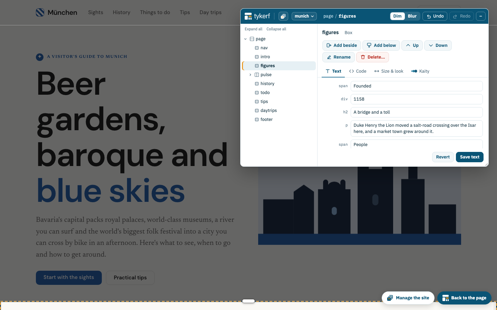

<p align="center"></p>

# TYKERF

**Make complex web pages understandable and editable. Let AI change one clearly scoped block at a time.**

TYKERF gives people and AI a shared language for building and changing web pages. A page in TYKERF is a **slicing tree**: the page is cut into rows and columns, and those into smaller ones, down to boxes that hold ordinary HTML. Every block has a name, so a person and an AI can point at the same thing. Every change is a named, validated move on the tree (add beside, make row, rename, resize…), so the layout can't be left broken, and every change can be undone.

- **Three ways to start a site:**
  - describe it, or show a screenshot or sketch, and TYKERF's assistant, **Kaity**, builds it while you watch;
  - copy an existing website;
  - pick a modern layout.

  All the pages of a site share one theme.
- **An editor that lives on the real page.** Open the page, press *Edit with TYKERF*, and a floating panel shows the tree. Select a block on the page or in the tree, then edit its text, its code, its size, or ask the AI to change it.
- **Kaity, an AI that works on one block.** Each block keeps its own conversation. Kaity only gets TYKERF's moves (no file or shell access), can only change the selected block, and looks at screenshots of its work at desktop and phone widths.
- **A whole site, managed in one place.** The site manager lists the pages (home page, titles, rename, duplicate, remove), the links between them with broken ones first, the code every page shares, the site's icon, and where Kaity is working. Kaity can also work across every page at once.
- **Publish in one click.** The site goes to a GitHub repository that GitHub Pages, Cloudflare Pages or Netlify serve, one commit per publish, only what changed. Or export a `.zip`, or let TYKERF serve the site itself while you sign in to edit it.
- **An MCP server** with the same moves, so any MCP client can edit a TYKERF page.



TYKERF is an [eonity](https://eonity.org) project.

## Quick start

Requirements: Node.js 22 or later. For the AI, one of:
- [Claude Code](https://claude.com/claude-code), installed and signed in (the default);
- an Anthropic, Anthropic-compatible or Gemini API key, in `.env` (see `.env.example`).

```bash
npm install
npx playwright install chromium     # used for screenshots, page checks and copying websites

npm start -- my-site                # a new or empty folder is a new site: open http://localhost:4400
npm start -- examples/widgets       # a sample page
npm start -- my-page --layout launch --theme studio   # one page directly (list: npm run cli -- layouts)
```

New to TYKERF? Read [Why TYKERF](docs/user-guide/en/why-tykerf.md) and [Getting started](docs/user-guide/en/getting-started.md). To choose which AI answers, see [Working with Kaity](docs/user-guide/en/ai.md#which-ai-answers).

TYKERF edits the page folder in place. Every change is recorded in its history, so *Undo* (⌘Z) goes back step by step.

## Documentation

| | |
|---|---|
| [User guide](docs/user-guide/README.md) | [Why TYKERF](docs/user-guide/en/why-tykerf.md), [getting started](docs/user-guide/en/getting-started.md) (with the AI, from a website, from a layout), [editing a page](docs/user-guide/en/editor.md), [layouts, components and the theme](docs/user-guide/en/layouts.md), [working with the AI](docs/user-guide/en/ai.md) (including Claude Desktop and other MCP clients), [copying a website](docs/user-guide/en/importing.md), [your site](docs/user-guide/en/sites.md) (the site manager), [publishing and serving](docs/user-guide/en/publishing.md), [exporting](docs/user-guide/en/exporting.md), [TYKERF in Claude Desktop](docs/user-guide/en/claude-desktop.md), [pages and the notation](docs/user-guide/en/workspaces.md) |
| [Developer guide](docs/developer-guide/README.md) | [Setup and tests](docs/developer-guide/en/setup.md), [architecture](docs/developer-guide/en/architecture.md), [the editor](docs/developer-guide/en/editor.md), [the AI and MCP](docs/developer-guide/en/ai-and-mcp.md), [extending TYKERF](docs/developer-guide/en/extending.md) |
| [DEPLOY.md](DEPLOY.md) | Publishing sites, running the editor for others, serving a site with sign-in, connecting MCP clients |
| [ROADMAP.md](ROADMAP.md) | What's done and what's next: Tydal storage, a hosted MCP server, a Chrome extension |
| [docs/slicing-notation.md](docs/slicing-notation.md) | The formal specification of the notation |
| [BRAND.md](BRAND.md) | Name, mark, colours and type |

## MCP server

The same moves, for any MCP client. For Claude Desktop there is a one-click extension: `npm run build:mcpb`, then open `dist/tykerf.mcpb` ([guide](docs/user-guide/en/claude-desktop.md)). For other clients:

```bash
claude mcp add tykerf -- /path/to/tykerf/node_modules/.bin/tsx /path/to/tykerf/src/mcp/server.ts --dir /path/to/page
```

Tools include `get_layout`, `split`, `wrap`, `flip`, `swap`, `move`, `set_ratios`, `set_content`, `edit_content`, `add_picture`, `rename`, `undo`, `redo`, `get_theme`, `set_theme`, `evaluate` (layout metrics at several widths) and `screenshot`. Each call validates the tree and replies with only the lines that changed.

## Command line

```bash
npm run cli -- outline "header main V footer H"     # parse and print the tree
npm run cli -- render examples/widgets             # write examples/widgets/out/index.html
npm run cli -- optimize examples/widgets 1440      # tune the ratios for a width (--write to save)
npm run cli -- import https://example.com my-page  # start a page from an existing site (see the guide)
npm run cli -- new my-page launch --theme studio   # start a page from a layout
npm run cli -- layouts                           # list page layouts and components
npm run metrics -- examples/widgets/out/index.html # overflow, line length, tap targets… at 375/768/1440
```

## Development

```bash
npm test            # vitest (core, sites, AI runners against fake APIs, browser tests, design checks)
npm run typecheck   # tsc --noEmit
```

The [developer guide](docs/developer-guide/en/README.md) explains the architecture, the editor, the AI and MCP, and how to add components, layouts, theme presets, moves, MCP tools and AI runners. See also [CONTRIBUTING.md](CONTRIBUTING.md).

## Background

TYKERF borrows the slicing floorplans of IC design: Otten (1982) for slicing structures, Wong & Liu (1986) for normalized Polish expressions and their moves, Stockmeyer (1983) for shape functions, and Nagy & Seth (1984) for the recursive XY-cut used by the importer. Full references are in [the notation spec](docs/slicing-notation.md). A *tykerf* is the cut a saw leaves.

## License

TYKERF is licensed under the [Apache License 2.0](LICENSE). It bundles the IBM Plex typefaces under the SIL Open Font License 1.1 (see [NOTICE](NOTICE)). "TYKERF", "TYDAL" and "Eonity" and their logos are trademarks of Eonity (see [NOTICE](NOTICE) and [BRAND.md](BRAND.md)).

<!-- tykerf:footer -->
---

[TYKERF](README.md) · [Documentation](docs/README.md) · [GitHub](https://github.com/eonity-org/tykerf) · Apache-2.0 · an [eonity](https://eonity.org) project
<!-- /tykerf:footer -->
