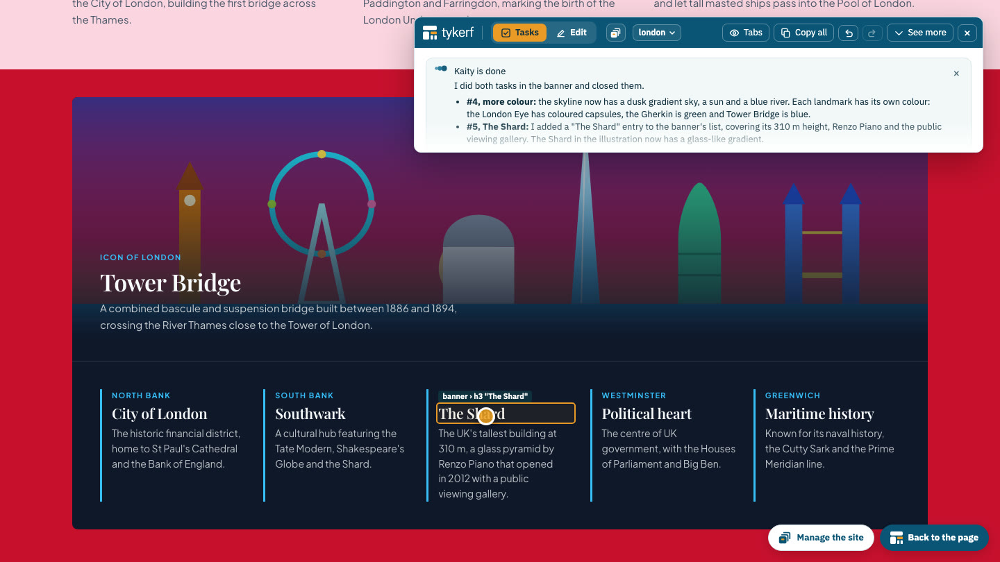

<!-- tykerf:header -->
&nbsp;

 › [Documentation](../../README.md) › [User guide](README.md) › **Getting good results from Kaity**
<!-- /tykerf:header -->

# Getting good results from Kaity

[Working with Kaity](ai.md) explains what Kaity can do and how to set her up. This page is about *how to ask*, in a task or in a request: what to write, in what order, and how to check her work. It ends with recipes for the jobs people ask for most.

*The video above was made with one request on the start screen. Everything in it, the illustrations, the games and the animations, is Kaity's first build, unedited.*

## How Kaity reads a request

Three things decide what Kaity does, before she reads a single word:

- **The block you selected.** Kaity changes that block and what is inside it, nothing else. A request about the footer sent from the hero is refused, however it is worded. Select the block first, or select `page` for something that spans the page.
- **The conversation of that block.** In the Edit mode's Kaity tab, each block keeps its own. Kaity remembers what you said about the hero when you ask about the hero again, but not what you said about the pricing table. *New conversation* starts over. A **task** carries its block, the element and the window width with it, so Kaity doesn't need you to select anything first.
- **What she can see.** Kaity reads the page as a tree of named blocks and their code, and she takes screenshots at desktop and phone width. She can't browse the web or download pictures: what she knows about your business is what you write or attach.

## Writing a request

A good request says **what**, **for whom**, **what it must contain** and **how it should feel**. You don't need all four every time, but the more of them you give, the less Kaity guesses.

| | Vague | Clear |
|---|---|---|
| What | "A page about our bakery" | "A launch page for our bakery" |
| For whom | | "for neighbours who walk past and tourists looking for breakfast" |
| Contents | | "our three best breads, opening hours, a map, and a line about the wood oven" |
| Feel | "nice" | "warm and simple, like a handwritten sign" |

Some habits that pay off:

- **Name the sections you want.** "Include facts, trivia, games and illustrations" gives Kaity a plan; "make it interesting" doesn't.
- **Give the real words when they matter.** Prices, opening hours, names and addresses should come from you. Kaity writes plausible text when she has none, and plausible is not the same as true.
- **Say what to avoid:** "no stock-photo look", "no pricing section", "keep it to one screen on a phone".
- **Name the language** when it isn't the one you are writing in: "Create a page in English about Lisbon…".
- **Attach a picture** instead of describing a look. A screenshot of a page you like, a sketch on paper or a design export says more than a paragraph. Say what to take from it: "the layout of the first picture, the colours of the second".
- **One topic per request** after the first build. "Make the hero shorter" and then "turn the features into a pricing table" work better than both in one message, and each is one step to undo.

## Writing a task

After the first build, most of your requests will be **tasks**: you point at an element in the **Tasks** mode and write a line. The task carries the block, the element and the window width with it, so say *what*, not *where*.

- **Loose is fine for looks.** "Make the illustration more colorful." "Make the background of this section pale yellow." "Add something about The Shard." Kaity looks at the page and chooses; if you don't like it, undo and say more.
- **Be exact for words, numbers and facts.** "The title: six words at most." "Opening hours: Tuesday to Sunday, 9 to 14." She writes plausible text when she has none to go on.
- **One thing per task.** Three small tasks work better than one with three parts, and each reply tells you what happened to each.
- **Point at the thing itself.** A task on a small label makes Kaity think you mean the label. If what you asked doesn't fit there, she says so and does it where it fits, and her reply tells you where.
- **Write it at the width where you see the problem.** The task remembers it ("too big on a phone").
- **Read her reply.** She closes each task with a short answer, and says what she didn't check (usually the phone width). Her replies also stay in the [handbook](editor.md#the-handbook).

## Start broad, then leave tasks

The fastest way to a good page is two passes:

1. **The whole page, once.** On the start screen (or *New page…*), *Show or describe it* with everything you know. Kaity picks a layout, builds every section, checks the result at desktop and phone width and goes once over what she left unfinished.
2. **Then tasks.** Look at the page in the **Tasks** mode and click what you'd change, one task each. Small, specific ones: "the title is too long, keep it under six words", "make this a dark band", "add a fourth card about the earthquake of 1755". Give them to Kaity all at once, or one block's at a time. To talk about one block at length, select it in the Edit mode and use its Kaity tab.

Undo is your friend: every step Kaity takes is a separate undo step, so if one change goes wrong you don't lose the others. ⌘Z goes back one step; the Kaity tab shows each step she took.

## Check her work

Kaity checks her own work, but you are the one who knows what the page is for:

- **Read the text.** Facts, names, numbers and quotes may be wrong. This matters most for anything a visitor will rely on: prices, dates, addresses.
- **Read her answer to each task.** It says what she did and what she skipped, and sometimes why she chose differently from what you wrote.
- **Look at a phone width.** Kaity checks 375 px, but drag the browser narrow anyway, or open the page on your phone.
- **Try what moves.** Games, quizzes, flip cards, menus: click them. Kaity tests the layout, not every interaction; her summary usually says what she didn't try.
- **Look at the list of what she left unfinished.** Sample text, placeholder pictures and links without a target are listed after every request. *Fix them* asks her to finish; *Leave them as they are* is fine for things you'll do yourself.
- **Look at scripts before you publish.** A `<script>` in a box is code like any other. Open the box's *Code* tab and read it, or ask Kaity "what does the script in this box do?" ([SECURITY.md](../../../SECURITY.md) explains why).

## Recipes

### A page from one sentence

On the start screen, choose *Show or describe it*, leave the theme on *Kaity chooses* and write the sentence. The page in the video came from this one:

> Create a page in English about Lisbon. Include facts, trivia, games, animations and illustrations about the city. Make it joyful and colourful.

Kaity chose the layout and the colours, drew the illustrations as SVG, and wrote a quiz and a memory game into their boxes. Then leave tasks: "add a section about the best viewpoints", "make the quiz ten questions".

### A page like a picture

Drop a screenshot, a sketch or a design ZIP (Google Stitch exports one) and add a sentence about what is different: "like this, but for a dental clinic, with our three treatments and a booking button". Kaity rebuilds the design with TYKERF's components and the theme. She doesn't copy code that loads things from other servers, so fonts and icons come from what TYKERF bundles.

### A layout, filled in

Start from *A layout*, then select `page` and ask: "fill this page for a bakery in Murcia: our breads are…, we open…". Kaity keeps the structure and rewrites every placeholder. This is the most predictable recipe: you choose the structure, she writes.

### Tidying a copied website

A [copy of a website](importing.md) is a starting point with the site's own code in each box. Ask Kaity about one box at a time: "simplify this box's code and use the theme's colours", "this section breaks on a phone, fix it". Remember that a copy of someone else's site is for studying only.

### A consistent site

Build the first page well, then add pages with *New page…* → *Like this page*, or ask from the start screen: "a page about Porto with the same layout as Lisbon". For changes that touch every page, use **Ask Kaity about the whole site** in the site manager: "make the navigation link to every page", "use the same footer as Lisbon on every page". Each page's changes go into that page's history.

### The same navigation and footer on every page

Don't ask for the navigation to be copied into each page: it drifts as soon as one copy changes. In the site manager, **Ask Kaity about the whole site**: "make the navigation and the footer one shared block for every page". She puts them in the [site kit](sites.md#the-site-kit), so a later change ("add Contact to the menu") reaches every page at once, and she says which pages it reaches. To make one page differ, select its navigation and ask for the page's own copy (*Make this page's own copy*). Asked about one block, Kaity can't change a shared block: she'll suggest the page's own copy, or that you ask her about the whole site.

The same goes for what every page shares: "give all buttons rounded corners" becomes a style in the kit, and "make the cards flip when hovered" a behaviour.

### Changing the look

Select `page` and ask about the theme: "make the accent a deep green", "headings in a serif", "more space between sections". In a site with several pages, Kaity changes only this page's values; change the look of every page in the Page tab (*Every page*).

### Several small changes at once

Go through the page in the **Tasks** mode (where the editor starts) and add a task on each thing to change, at the width where you see it (see [Tasks](editor.md#tasks)). Then **Give Kaity every task** in the list, or **Give it to Kaity** on one block's tasks: she gets each open task with where it is and how wide the window was, works through them and closes each one with a short reply you'll see next to it. Tasks she couldn't do stay open, and she says why. From Claude Code or another MCP client, ask it to work through the page's tasks: it reads them with `list_tasks` and closes them with `close_task`.

## When to do it yourself

Kaity is quick at building and restructuring; you are quicker at small, exact changes, in the **Edit** mode:

- **A word or a link:** double-click it on the page and type.
- **A picture:** double-click it to replace or crop it.
- **A width or a height:** drag the handle on the page.
- **Order of sections:** *Up* and *Down* in the panel.

Each of these is one undo step too, in the same history as Kaity's.

## Time and cost

Every request runs on your AI account (see [Which AI answers](ai.md#which-ai-answers)). Building a whole page takes a few minutes and is the most expensive request; a change to one block takes seconds to a minute. Kaity takes screenshots to check her work, and pictures cost more than text, so asking about a small block costs less than asking about `page`.

<!-- tykerf:footer -->
---

← [Working with Kaity](ai.md) · [User guide index](README.md) · [Layouts, components and the theme](layouts.md) →

[TYKERF](../../../README.md) · [Documentation](../../README.md) · [GitHub](https://github.com/eonity-org/tykerf) · Apache-2.0 · an [eonity](https://eonity.org) project
<!-- /tykerf:footer -->
