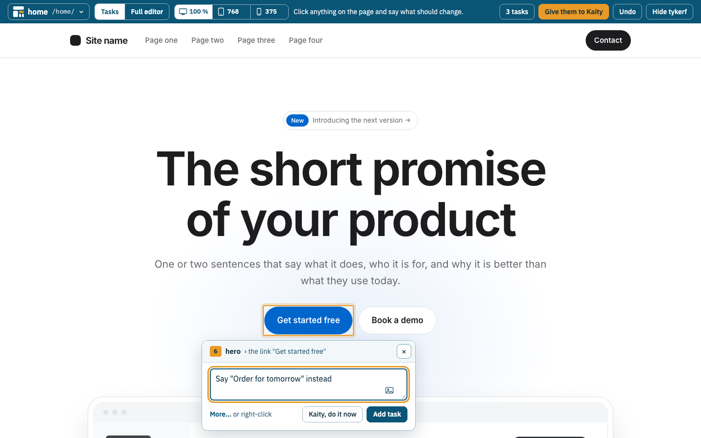
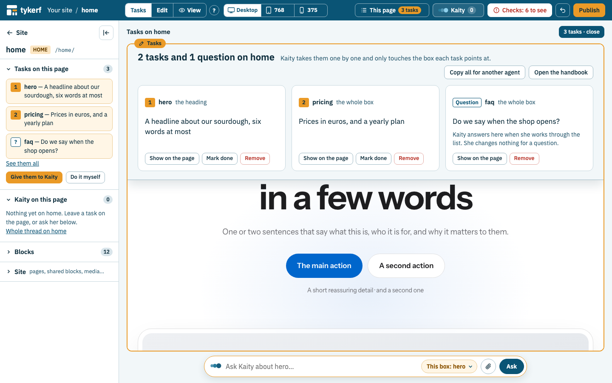
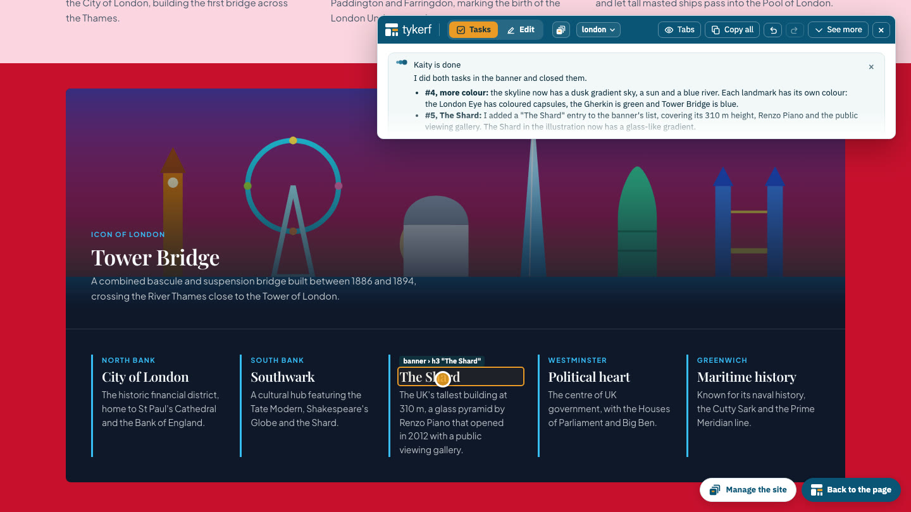
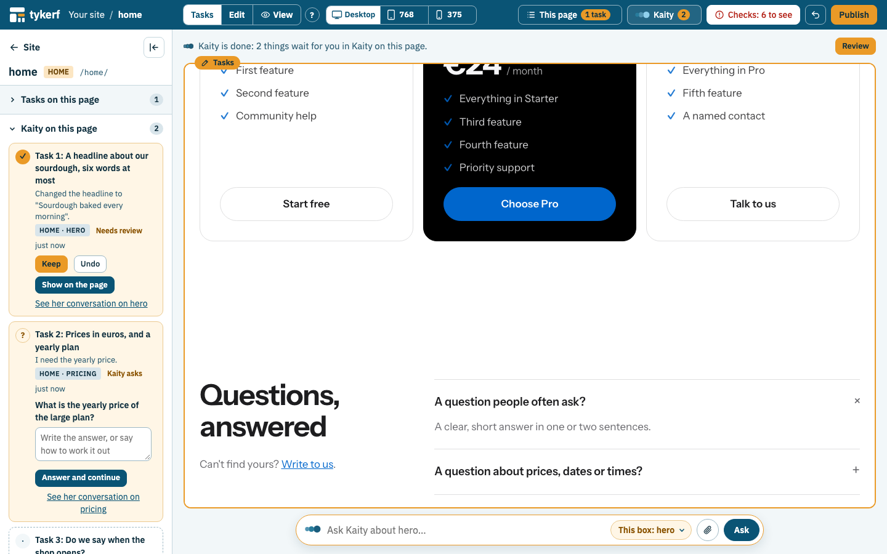
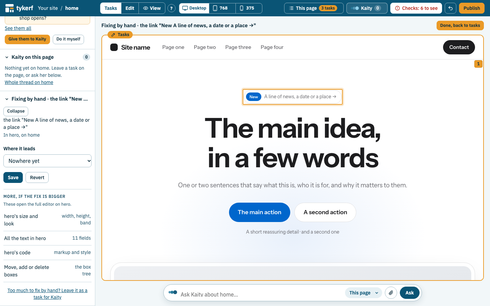
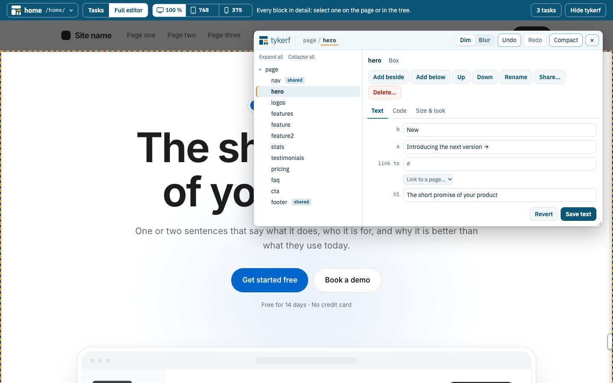

<!-- tykerf:header -->
&nbsp;

 › [Documentation](../../README.md) › [User guide](README.md) › **Editing a page**
<!-- /tykerf:header -->

# Editing a page

Open the page in the browser (by default http://localhost:4400). The page fills the window at its real width, and one thin bar sits on top: that bar is all of TYKERF until you ask for more. Everything else (your tasks, Kaity at work, the site, fixing something by hand) slides in from the top or the left when you need it, and goes away again. TYKERF never draws inside the page or changes its look.

## The bar

From left to right: the **page switcher** (the TYKERF mark, the page's name and address; it opens [the site](sites.md#the-sites-screens)), a hint or what Kaity is doing, then the **number of open tasks** (it opens them), **Give them to Kaity**, **Undo** (point at it to see which step it takes back) and **Hide tykerf**. After the page switcher, **Tasks | Full editor** switches between the two ways of working on the page, and three small buttons show the page **at full width, on a tablet held upright (768 px) or on a phone (375 px)**: the page lays out again at that width, and a task you write then remembers it. Each button says its size; the full-width one says how much the page is shown at (*100 %*, or *72 %* when it is shrunk to fit beside a panel). Escape goes back to full width. On a narrow window the bar wraps.

## Tasks

Leaving tasks for Kaity is the normal way to work. A task is something to be done, left on the exact place on the page it is about: a change to make, or a question.

- **Click anything on the page.** The element under the pointer is outlined in orange; a click opens the task box by it. Its top line has the task's number, the box it is in (point at it: Kaity changes only that box) and the element in words (*the button "Get started free"*); at a tablet's or a phone's width, that width too; **×** (or Esc) cancels. Write what should change and press **Add task** (⌘↵ / Ctrl+↵), or **Kaity, do it now** to hand over this one at once. The picture button in the corner of the field (or a paste or drop on the box) sends up to five pictures with the task: a screenshot, a sketch, a design to follow. For anything else, **More…** at the bottom left of the box (or a right-click on the page) opens the menu: fixing it by hand, editing its words, adding or deleting boxes. Nothing on the page reacts to clicks: links don't go anywhere, buttons don't press.
- **A question:** end what you write with `?` and the number turns into **Question**; a click on it switches between task and question. Right-click → *Ask a question here…* opens the box as a question. Kaity answers a question and changes nothing.
- Each open task leaves a **numbered pin** on its element (a question shows `?`). A pin opens the tray on its task.
- **The tray** (the number of tasks in the bar) lists every open task and question as a card: *Show on the page*, *Mark done* and *Remove*. *Copy all for another agent* copies them as text, for any AI agent or a message; *Open the handbook* opens [the handbook](#the-handbook).
- A task remembers **how wide the window was** when you wrote it, so whoever does it looks at the page at that width ("too big on a phone").
- Tasks aren't part of the page and don't go with an export, but adding, changing, closing or removing one is a step: **Undo** takes it back like any other change. They follow a block when it is renamed; a task whose block was deleted says so.

## Kaity at work

**Give them to Kaity** hands over every open task on the page. She takes them **one at a time**, and on each she changes **only the box the task points at**; questions come last. While she works:

- The bar says *Kaity is working · task 2 of 3*, with the task she is on, and **Stop Kaity**, **Undo all she did** and *Hide the steps*.
- The tray shows each task: **done** with what she changed, in a sentence; **now** with what she is doing; **waiting**, which *Take it off her list* skips.
- On the page, her element is outlined with *2 · Kaity is here*, and the page scrolls to it (scroll yourself, and it stops following for a few seconds). Finished tasks' pins read *1 done*.

You can keep leaving tasks meanwhile, and *Ask for more* on a finished one: they join the end of her list.

## The review

When she stops, the bar sums it up (*Kaity stopped · 2 done, 1 answered, 1 needs you*) with **Keep the changes** and **Undo all she did**. In the tray:

- A **done** task has a way to check it that fits it (*See it on a phone* shows the page 375 px wide, as the bar's phone button does; *Try the button* or *Try the link* lets the page react until **Done trying**, a link to elsewhere only saying where it leads), **Before and after** (pictures of the box before she started and after), **Undo this one** (only that task's work, wherever it is in the history; Undo brings it back), **Ask for more** and *See her conversation on …* (everything asked on that box, her steps and answers, to read).
- When she **left something unfinished** in it (sample text, a placeholder picture, a link that goes nowhere), the card lists it: **Fix them** has her finish it as part of the task; **Leave them as they are** keeps it, and it isn't listed again.
- When she **needs you** (a price, a name, which of two options), the card shows her question and a field: **Answer and continue** gives her the answer and she goes on; *Leave it for later* keeps the task open.
- An **answered question** shows what you asked and her answer, with *Ask a follow-up* and *Got it*.
- When her answer or her summary points at something you can do in one click, the card has it as a button: **Share hero with every page** (the box becomes one of the site's shared blocks, as on *Shared blocks*), **Open hero** (to fix it by hand) or **Go to about**. A button goes once it's done.

**Keep the changes** closes the review. Everything she did stays a normal change, which Undo takes back step by step.

## Fixing one thing by hand

When it is quicker to do it yourself, right-click the element and choose **Fix it by hand**: it opens a narrow panel on the left with **only that element**: a button's or link's words and where it leads (nowhere yet, a box of this page, a page of the site, or another address), a heading's or paragraph's words, a picture's description and *Choose another picture…*. **Save** writes it into the box; **Revert** puts back what is there. One line says whether the box is the same on another page (the fix stays on this one unless you share the box) or is a shared block (the fix reaches every page that shows it).

While the panel is open, a click on the page picks the next thing to fix, and the bar says *Fixing by hand · …* with **Done, back to tasks**. **More, if the fix is bigger** opens [the full editor](#the-full-editor) on the box, at the tab for it: its size and look, all its text, its code, or the box itself to move, add or delete boxes. *Too much to fix by hand?* leaves it as a task for Kaity instead.

## Over the page, or shrunk to fit

The panels on the left (the site, fixing by hand) open **over the page**: the page doesn't move. **Shrink the page to fit**, at their top, puts the page beside the panel instead: it keeps its real width, so nothing moves around in it, and is shown smaller (the task box stays at its own size); the bar says how much. TYKERF remembers your choice. In the full editor the page is never shrunk (its panel is part of the page and would shrink with it): the site opens over the page there, and *Shrink the page to fit* is greyed out.

## The second button

**Right-click** anything on the page for what can be done there:

- *Leave a task here…*, *Ask a question here…* and *Fix it by hand*;
- *Edit this text*, for a heading, a paragraph, a link or a button that holds only words: type the new words right on the page; **Enter** keeps them, **Esc** puts them back. **Double-click** the words does the same, as in the full editor;
- *Add a box below…* or *Add a box beside…*: a new empty box, and the task box opens on it to say what should go there (Kaity fills it), or leave it empty;
- *Delete this box…*, asked first: its code goes into the box before it;
- *Open … in the full editor*, for everything else (renaming, sizes, code, moving boxes), and *Hide tykerf*.

Each of these is one step that **Undo** takes back.

## Hide tykerf

**Hide tykerf** shows the page as a visitor sees it, with nothing of TYKERF on it but a **Show tykerf** button in the corner. **Alt+Shift+T** goes either way.

## The full editor

The full editor is the expert way, beside tasks, for long manual work: restructuring a page, editing many boxes in a row, code, the page's theme. The page's blocks are in a tree, and each block's text, code, sizes and look are there by hand. **Full editor**, next to **Tasks** in the bar, switches to it (on the box you are fixing, when you are), and so do a right-click's *Open … in the full editor* and the quick fix's *More*. The bar stays as it is (the pages, the site, Hide tykerf); the panel floats over the page; **Tasks** comes back, and every page opens in Tasks. Kaity is asked with tasks there too: right-click → *Add a task for Kaity here…*. The rest of this page describes it.

### Selecting

- **Click** a box on the page, or a line in the tree, to select it.
- **Esc** selects the container one level up. The path at the top of the panel (`page / intro / header / title`) is clickable too.
- **Right-click** a box on the page for its tools. Small ones happen right there: *Edit this text*, *Edit image…*, *Rename…* and *Delete…* open next to the pointer; *Edit code* and *Sizes…* open the panel; *Add a task for Kaity here…* leaves a task on the element, and *Add and give it to Kaity* takes you to Tasks, where she works on it.
- **Double-click** text or an image to edit it in place (see below).
- Everything outside the selection is **dimmed** or **blurred** (*Dim/Blur* in the panel header; Blur suits colourful sites). The selected block keeps its colours inside a dashed amber frame.
- The box under the mouse gets a moving outline and its name.
- While editing, the page is for pointing: links, buttons and forms don't react. Press **Back to the page** to use it normally.
- **⌘Z** (Ctrl+Z) undoes the last change, whoever made it, you or Kaity. **⇧⌘Z** (Ctrl+Y), or the arrow next to *Undo*, redoes it. Redo works until you make a new change. The last 200 steps can be undone; older ones stay listed in `.history-archive.jsonl`.
- **Box scripts run here** with the editor's own access, so open only pages whose code you trust (see [SECURITY.md](../../../SECURITY.md)).

### The panel

Drag it by its header and resize it from its corner; it remembers where you left it. **Compact** makes it small, only its header; **See more** opens it again. **×** closes the full editor and goes back to Tasks. On phones it docks at the bottom. Its header is light, under the bar, with the tykerf mark so it never looks like part of the page; the selected block's name is underlined in amber, the colour of the task box and of the frame round the block. While [the site](sites.md#the-sites-screens) is open on the left, the editor makes itself compact beside it (*Compacted while the site is open*), so the page stays in view; closing the site brings it back as it was. **See more** opens it anyway.

| Zone | What it shows |
|---|---|
| Header | Only what belongs to editing: the path of the selected block, Dim/Blur, Undo, Redo, Compact and **×** (back to Tasks). The pages, the site, export and Kaity are in the bar and [the site's screens](sites.md#the-sites-screens) |
| Tree | The whole page. **Boxes** (a small square) hold code; **containers** hold blocks. A container's icon shows its cut: a vertical line for blocks side by side (a *row*), a horizontal line for stacked blocks (a *column*). Hover a line to see the block on the page |
| Work area | Everything for the selected block. Each block keeps its own tab and unsaved drafts |

### Actions

- **Add beside / Add below:** a new empty box next to the selection. It joins the parent if the parent already runs that way; otherwise the selection is wrapped in a new row or column.
- **Add inside, Make row / Make column, Ungroup** (containers).
- **Up / Down** (or **Left / Right**): move the block among its neighbours.
- **Rename**, or click the name: every reference follows, and so does the block's conversation with Kaity.
- **Paste…**: put back code you removed (see below), into this box or as a new box beside, below or inside.
- **Delete…**: see below.
- **Share…** (a box in a site): make it a shared block that every page can show, or show one the site already has. A box that shows one is marked **shared** and offers **Make this page's own copy**; see [the site kit](sites.md#the-site-kit).

### Editing in place

**Text.** Double-click a heading, paragraph, button or list item. It becomes editable where it is, with a small toolbar above it.
- Type to change the words. **⌘B** bold, **⌘I** italic, **⌘K** link (or the toolbar); in a site the link box lists the site's pages to pick from. **Shift+Enter** starts a new line.
- **Enter**, *Done* or a click elsewhere saves; **Esc** cancels. Each save is one undo step.
- Pasting adds the words only, without the formatting they had.
- Only words, bold, italic and links change this way, so the box's code stays clean: no styles or extra tags are added. Layout and structure are changed in the *Code* tab.
- Text next to other elements (an icon in a button, say), or text the box changes with a script, opens in the *Text* tab instead.

**Images.** Double-click an image (or right-click → *Edit image…*):
- **Replace** it: *Choose a file…*, drop one on the tool, or pick one the page already has (*From this page…*). PNG, JPEG, GIF, WebP and AVIF, up to 15 MB.
- **Crop** it: drag the frame, a corner, or an edge (an edge changes only the width or only the height). *Shape* keeps it free, as the original, as it shows on the page, or at 1:1, 4:3, 3:2 or 16:9.
- **Undo a crop later:** opening a cropped image shows the whole original with the crop on it. Drag the frame wider, or choose *Original*, and *Apply*. *Start over* goes back to the whole image, not turned, at its size.
- **Turn** it by a quarter, and limit its **largest side** (2400, 1600, 1200 or 800 px) so the page loads faster.
- Write its **image text** for people who can't see it.
- *Apply* saves the result as a new file in `assets/` (the original stays) and points the image at it: one undo step. PNG stays PNG; other photos are saved as JPEG. GIF and SVG images can be replaced but not cropped.
- **Its size on the page** comes from its box. With the **Image** component (a picture and a caption) the image fills its box, so the box handles size it: the right edge makes it narrower (centred), the handles between boxes side by side share the width, the bottom edge makes it taller (a taller box shows more of the picture, cut to fit, never stretched). An image inside a larger section (a hero) is sized by that section's layout: change it in the *Code* tab, or ask Kaity.
- An image from another site (an imported page) can be copied into the page first with *Copy into the page*, so the page stops loading it from there.

### Tabs

- **Text** (boxes): the box's words, link targets, image addresses and image descriptions as plain fields. The markup stays as it was.
- **Code** (boxes): *Content* (markup and scripts), *Style* (CSS that only applies to this box) or *Full code*. ⌘S saves.
- **Size & look:**
  - **Look**, at the top:
    - **Band:** *None*, *Alternate* (a shade of the background), *Soft* (a wash of the accent) or *Dark* (its text turns light).
    - **Density:** *Normal* or *Dense* (less space around it, smaller titles).

    - **Site tags**, in a site whose kit has them: the site's own tags, on or off (see [the site kit](sites.md#the-site-kit)).

    The theme gives the colours, so a band always matches the page. It works on any block: a box, whatever its code, or a whole container. Each change is one undo step.
  - **Widths** of blocks side by side, with *Equal widths*. Handles also sit on the page between the blocks.
  - **Width** of the selected block when it isn't side by side with others: narrower than the space it has, and centred. The handle on its right edge does the same on the page; double-click it, or press *full*, to make it full width again.
  - **Heights** of stacked blocks, as a minimum height. A block can be made taller, never shorter than its content. Double-click a height handle, or press *auto*, to go back to the content's height.
  - The page previews while you drag; the change is saved, as one undo step, when you let go.
- **Blocks** (containers): the blocks inside, in order, each with its band and density when it has them (*Soft band*, *Dark band*, *Dense*…).
- **Page** (the top block): the theme (colours, fonts, spacing) and the page's head code. See [layouts, components and the theme](layouts.md).

An empty box's Text tab offers **Use a component** (ready-made sections with placeholders), **Import a section** (a part of another website, see [copying a website](importing.md)), **Write code** and **Leave a task for Kaity**. *Import a section…* is also in the right-click menu of every box.
- **Kaity:** tasks, from Tasks or a right-click; see [Working with Kaity](ai.md).

## The handbook

*Open the handbook* in the tray (or *Handbook* at the top of the full editor's **Page** tab) opens the page's system on one page, in a tab of its own: the theme (colours as swatches, fonts as samples, sizes and spacing as bars) and every block in page order, with chips to copy its name, its path or its link (`#sw-<name>`) into a request, and its tasks: the open ones, then the ones that are done with their reply, a record of what was decided. It is made from the page as it is now, so it is never out of date. **Markdown** downloads the same as text, for an AI agent or a colleague.

### Delete or Remove

Taking a block out asks what should happen to its code:

- **Delete:** the code moves to the end of the **previous box** in reading order (or the next box, if it was the first). Nothing is lost and the page still shows it.
- **Remove:** the code goes to the **buffer** and leaves the page. *Paste…* puts it back anywhere. The buffer keeps the last 20 items.

For a container, the code of all its boxes goes together, in reading order. Both are one undo step.

## Not yet

Blocks can't be dragged to new places (use Up/Down and Kaity), and wheel layouts are shown as plain containers. Images that are no longer used stay in `assets/` (so undo can bring them back) until you clean them up in the top block's **Page** tab: *Unused files* lists those that no box, the head, the paste buffer or an undo step uses, and *Move them to the trash* puts them in the page's `.trash/` folder.

<!-- tykerf:footer -->
---

← [Getting started](getting-started.md) · [User guide index](README.md) · [Working with Kaity](ai.md) →

[TYKERF](../../../README.md) · [Documentation](../../README.md) · [GitHub](https://github.com/eonity-org/tykerf) · Apache-2.0 · an [eonity](https://eonity.org) project
<!-- /tykerf:footer -->
