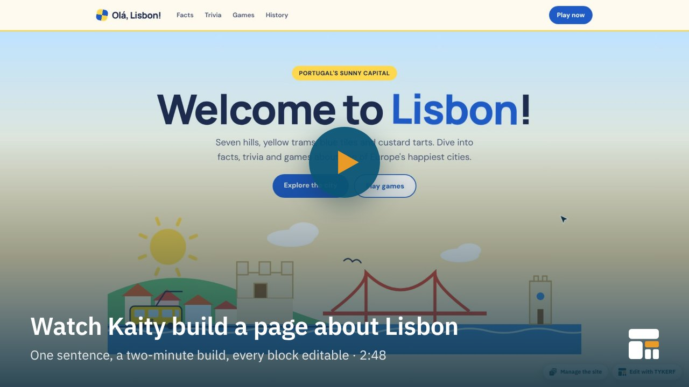
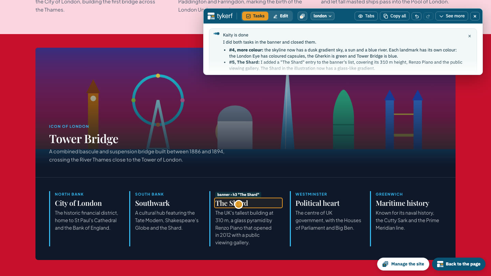

<!-- tykerf:header -->
&nbsp;

[](../../../README.md) › [Documentation](../../README.md) › [User guide](README.md) › **Getting started**
<!-- /tykerf:header -->

# Getting started

This page takes you from nothing to a first page you can edit, and explains the ways to start a site. To see why you might want TYKERF at all, read [Why TYKERF](why-tykerf.md) first.

## Install

You need [Node.js](https://nodejs.org) 22 or later. For Kaity, TYKERF's assistant, you need one of these:
- [Claude Code](https://claude.com/claude-code), installed and signed in. This is the default, and TYKERF needs no key of its own.
- An API key for Anthropic, an Anthropic-compatible service or Gemini (see [Which AI answers](ai.md#which-ai-answers)).

```bash
git clone https://github.com/eonity-org/tykerf.git
cd tykerf
npm install
npx playwright install chromium     # a browser TYKERF uses for screenshots, checks and copying websites
```

## Start a site

A **site** is a folder of pages. Start TYKERF on a new or empty folder:

```bash
npm start -- ~/tykerf-sites/bakery
```

Open http://localhost:4400 (another port: add `--port 4500`). A new site opens on **New page**: what page you want, its name (`home` is fine), and how to start.

## Three ways to start

### 1. Show or describe it, and Kaity builds it

The quickest way, and the first choice when Kaity is ready.

1. **Show it:** drop, paste or choose up to three pictures: a screenshot of a page you like, a sketch on paper, a mock-up. You can also drop a design exported as a ZIP file (from Google Stitch, for example): Kaity gets its pictures and reads its text files (the design notes, the page's HTML and CSS) to follow its colours, fonts and sections.
2. **Describe it:** write what the page should be. Be concrete about who it is for, what it must say, and the feel:
   > A page for our bakery in Murcia: warm and simple, our three best breads, opening hours and a map.

   Either one is enough; both together work best.
3. Choose **Build it with Kaity**. She works out what the page is for, starts from the layout that fits it with only the sections it needs, and says which and why. She picks the theme that fits, or takes the colours and fonts of your design.

The page starts empty. Kaity starts from the page layout that fits your request best (a launch page, a magazine, a portfolio, a data page…), then shapes it and rewrites all its text for you.

TYKERF makes the page at once and opens it in the editor. The bar says *Kaity is building* the page and the tray under it lists her steps, while the page fills in below. Meanwhile she:
- plans the sections and starts each from a ready-made component;
- writes the text, alternates light and tinted bands, and puts a dark footer at the end;
- looks at the result at desktop and phone width and fixes what looks wrong.

It takes a few minutes and uses your AI account. **Stop Kaity** in the bar stops her; what she built so far stays.

When it is done, the bar says *Your page is ready* and the tray shows her summary; **Got it** puts it away. Then click anything on the page and say what should change, and give your tasks to Kaity (see [Tasks](editor.md#tasks)). **Full editor**, in the bar, is for every block in detail by hand.

Every step is an ordinary change, so you can undo any of them.

[](https://eonity.org/tykerf-guides/videos/tykerf-builds-lisbon.mp4)

*This video shows the whole flow, from the first request to the finished page, with this request: "Create a page in English about Lisbon. Include facts, trivia, games, animations and illustrations about the city. Make it joyful and colourful." For what makes a request work, see [Getting good results from Kaity](asking-kaity.md).*

**Best for:** a page you can picture or describe, or a design you saw somewhere and want something like it.

### 2. A copy of a website

TYKERF opens an existing page in a browser, measures it at desktop and phone widths, and cuts it into rows, columns and boxes you can edit. Write the address and choose **Copy the page**. Tick **Only the layout** to keep the structure without the site's text, images and styles. The page opens at once, and the bar and the tray follow the copy: opening the site, measuring it, cutting it into blocks, copying the styles. It usually takes under a minute; **Got it** puts the steps away. **Stop the copy** in the bar stops it and removes the unfinished page (to the site's `.trash/` folder).

**Best for:**
- moving your own site into TYKERF;
- starting from a structure you like.

Read [what you may do with a copy](importing.md#what-you-may-do-with-the-copy) before you publish one: a copy of someone else's site is for studying and prototyping only. You can also copy just one part of a site into a box later (*Import a section…*, see [Copying a website](importing.md)).

### 3. A layout

Pick what the page is (a place, a person, an event, an organisation, a concept, a post or a guide, or *Just the frame* to start almost empty), what holds it (*simple*, *basic* or *full*), and, for a site's first page, its theme. Each choice is described as you pick it; **Preview at full size** shows the page. Then replace the placeholder text and images, or ask Kaity to fill them in ("fill this page for a bakery in Murcia").

The seven themes each suit a tone: *Studio* (airy, modern), *Ivory* (editorial, warm paper), *Natural* (outdoors, green and clay), *Vivid* (loud, one strong colour), *Civic* (plain and clear, easy for everyone to read), *Playful* (friendly, round, pastel) and *Dark* (for developers). Any page works with any theme, so the pair sets the page's colour, type and density.

A page starts from **components**, ready-made sections such as an introduction, an offer list or a programme. Later you can drop any component into any box on its own (*Use a component*), and the **theme** styles them all; see [how they differ](layouts.md).

**Best for:**
- a solid layout in seconds;
- when Kaity isn't set up yet;
- when you'd rather write every word yourself.

### Which one?

| You have… | Start with |
|---|---|
| An idea, a sketch or a screenshot of a page you like | **Show or describe it** |
| A site already (yours), or a layout you want to study | **A copy of a website** |
| No AI set up yet, or you want to write every word | **A layout** |

None of these locks you in. Every page, however it started, is the same kind of TYKERF page: you can edit it by hand, ask Kaity about any block, use components and change the theme.

## More pages

Click the page's name at the left of the bar, and **+ Page** in the site it opens. You get the same three ways. A new page from a layout gets the site's navigation and footer, shared: change them once and every page follows (see the [site kit](sites.md#the-site-kit)). To make a page like another one, ask Kaity: "a page about Porto like Lisbon".

**One theme for the whole site.** All the pages of a site share the theme the first page set: its colours, fonts and spacing. Change it in the full editor's **Page** tab of any page and every page follows. A page can still set its own colours or fonts with *This page only*, and the Page tab always says whether a page's look is inherited from the site (see [the theme](layouts.md#the-theme)).

## Your first changes: tasks

Open the page: the editor's bar is on top, and tasks are all you need at first.

1. **Click** anything on the page (a title, a button, a section) and write what should change: "make this shorter", "add a Pricing link here". Press **Add task**. The task stays on its spot as a numbered pin.
2. Leave as many as you like, at the window width where you see each problem.
3. Press **Give them to Kaity**. She works through them one at a time, the page shows where she is, and the tray shows what she did with each one: check it, undo one, or answer her question.

Every change she makes is a step you can undo. See [Tasks](editor.md#tasks).

[](https://eonity.org/tykerf-guides/videos/tykerf-tasks.mp4)

*Two loose tasks, "make the illustration more colorful" and "add something about The Shard", written on the page and given to Kaity. She changes the skyline's colours and adds a caption about The Shard.*

## What next

- **[Tasks and the editor](editor.md):** tasks first; fixing one thing by hand; and the **full editor**, for exact changes to any block (select blocks, edit text and images where they are, resize, move, undo anything).
- **[Getting good results from Kaity](asking-kaity.md):** how to write a task or a request, and recipes.
- **[Manage the site](sites.md):** the page's name at the left of the bar opens the site: its pages to open, rename, duplicate or remove, the home page and titles, the tasks of every page, the site kit (a navigation and a footer shared by every page), the site's check, media, links between pages and its icon. The link box (⌘K) lists the site's pages, and renaming a page updates every link to it.
- **[Put it online](publishing.md):** **Publish**, at the bottom of the site's sidebar, sends the site to GitHub Pages, Cloudflare Pages or Netlify; **Export the site** there gives a .zip of plain files for any web host.

<!-- tykerf:footer -->
---

← [Why TYKERF](why-tykerf.md) · [User guide index](README.md) · [Editing a page](editor.md) →

[TYKERF](../../../README.md) · [Documentation](../../README.md) · [GitHub](https://github.com/eonity-org/tykerf) · Apache-2.0 · an [eonity](https://eonity.org) project
<!-- /tykerf:footer -->
