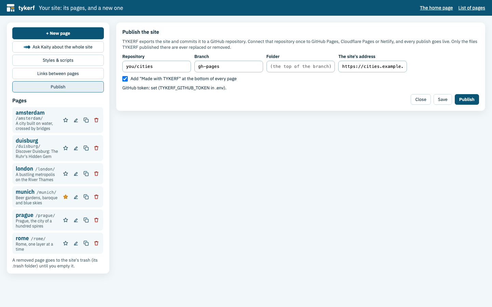

<!-- tykerf:header -->
[](../../../README.md) › [Documentation](../../README.md) › [User guide](README.md) › **Publishing and serving a site**
<!-- /tykerf:header -->

# Publishing and serving a site

A TYKERF site is plain HTML once it leaves the editor: no TYKERF script, no requests to TYKERF. There are three ways to put it online:

| | How | Best for |
|---|---|---|
| **Publish** | The site manager commits the site to a GitHub repository; GitHub Pages, Cloudflare Pages or Netlify put it live | Most sites: free hosting, HTTPS, a history of every publish |
| **Export** | Download a `.zip` and upload it to any web host | A host that isn't connected to GitHub |
| **Serve it with TYKERF** | TYKERF itself serves the pages to visitors, and you edit on the same server after signing in | Editing the live site directly |

## Publish

**Publish** in the site manager exports the site and commits it to a GitHub repository, with no git needed on your machine. A host connected to that repository puts every publish live within a minute or two.



### Once

1. **A repository** on GitHub. For GitHub Pages on a free account it must be public; Cloudflare Pages and Netlify also take a private one. An empty repository is fine: the first publish starts it with a README.
2. **A token** that may write to it: on GitHub, [make a fine-grained token](https://github.com/settings/personal-access-tokens/new) (*Settings → Developer settings → Personal access tokens → Fine-grained tokens*) with access to that repository only, and *Contents: read and write*. Put it in TYKERF's `.env` and restart TYKERF:
   ```bash
   TYKERF_GITHUB_TOKEN=github_pat_...
   ```
   The token never leaves TYKERF's server: the site manager only says whether one is set.
3. **Where it goes:** in **Publish**, the repository (`you/your-site`), the branch (`gh-pages` by default), a folder if the site shouldn't be at the top of the branch (`docs`), and **the site's address** (`https://you.github.io/your-site`, or your own domain). The address is used for `sitemap.xml` and for the links of the *not found* page.
4. **Connect a host** to the repository and branch (the steps for each are in [DEPLOY.md](../../../DEPLOY.md#publish-a-site-to-github-cloudflare-pages-or-netlify)):
   - **GitHub Pages:** the repository's *Settings → Pages → Deploy from a branch*. The site is at `https://you.github.io/your-site/`.
   - **Cloudflare Pages:** *Workers & Pages → Create → Pages → Connect to Git*, framework preset *None*, no build command.
   - **Netlify:** *Add new site → Import an existing project*, no build command.

   A custom domain is set on the host's side (Cloudflare and Netlify take it in their settings; for GitHub Pages, add a `CNAME` file to the branch). Then write that domain as the site's address in **Publish**.

### Every time

Click **Publish**. TYKERF says how many files are new, changed and removed, with links to the commit and the site; when nothing changed since the last publish, nothing is sent.

- **One publish is one commit.** The repository's history is the list of your publishes; to take one back, revert its commit on GitHub.
- **Only what changed is sent**, and only files TYKERF published before are ever replaced or removed (it keeps their list in `.tykerf-published.json`). A `CNAME`, a README or your own files in the repository stay.
- **It waits while Kaity is working**, so half a change never goes live.
- The same checks as an export: links to pages that don't exist, and files still loaded from other servers.

### What a published site holds

| File | |
|---|---|
| `index.html` | Opens the home page |
| `<page>/index.html` | Each page, with its images in `<page>/assets/` |
| `pages/index.html` | The list of pages |
| `404.html` | What the host shows for an address that isn't there: *This page isn't here*, and the list of pages |
| `favicon.svg` | The site's icon ([Styles & scripts](sites.md#styles--scripts)) |
| `sitemap.xml` | For search engines, when the site's address is set |
| `.nojekyll` | Tells GitHub Pages to serve every file as it is |

**Made with TYKERF.** Every published page ends with a small line, the TYKERF mark and *Made with TYKERF*, linking to TYKERF's repository; the list of pages links there too. It takes the theme's colours and fonts. To leave it out, untick *Add "Made with TYKERF" at the bottom of every page* in **Publish**. Exports you download don't have it.

## Export

Click the **Site** button in the editor (between the TYKERF logo and the page name) and choose **Export the site…** or **Export this page…**. See [Exporting](exporting.md) for the options and what to check.

## Serve it with TYKERF

TYKERF can serve the site to visitors itself, on a server of yours: visitors get the pages as they are, and only you edit, after signing in. In `.env`:

```bash
TYKERF_ADMIN_PASSWORD=a-long-passphrase       # turns sign-in on
TYKERF_PUBLIC_URL=https://cities.example.org  # the site's address
```

- **Visitors** get the pages without the editor, their images, `/`, `/pages/`, `/sitemap.xml` and the site's icon. Every editor address answers *sign in first*.
- **You** sign in at `/_tykerf/login`; the list of pages links to it (*Sign in to edit*). **Sign out** is in the site manager.
- Run it behind a proxy that does HTTPS (Caddy or nginx). [DEPLOY.md](../../../DEPLOY.md#serve-a-site-to-visitors-with-an-admin) has the setup.

Without `TYKERF_ADMIN_PASSWORD`, TYKERF is a local editor: anyone who can reach it edits, and uses your AI account. Don't put it on the internet that way.

<!-- tykerf:footer -->
---

← [Your site](sites.md) · [User guide index](README.md) · [Exporting a page or a site](exporting.md) →

[TYKERF](../../../README.md) · [Documentation](../../README.md) · [GitHub](https://github.com/eonity-org/tykerf) · Apache-2.0 · an [eonity](https://eonity.org) project
<!-- /tykerf:footer -->
