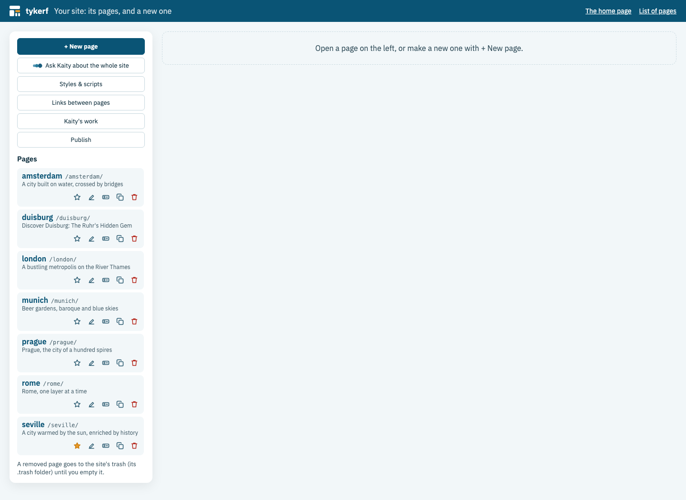
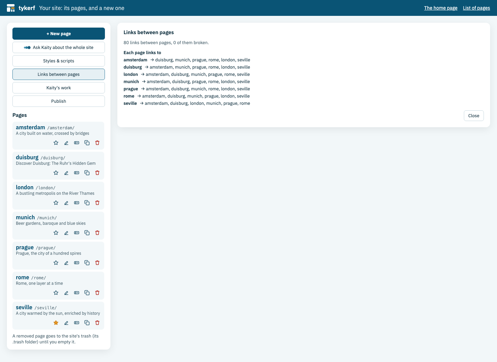
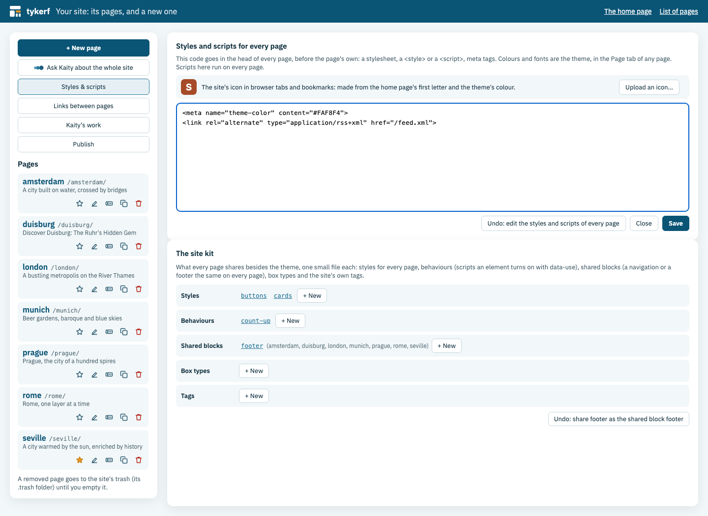

<!-- tykerf:header -->
&nbsp;

[](../../../README.md) › [Documentation](../../README.md) › [User guide](README.md) › **Your site**
<!-- /tykerf:header -->

# Your site

A **site** is a folder of pages, one subfolder each, with what they share next to them:

```
my-site/
  home/          a page (layout.slice, boxes/, head.html, assets/ …)
  about/         another page
  head.html      the site's theme and the code every page gets (Styles & scripts)
  kit/           what every page shares besides the theme (see The site kit)
  assets/        the theme's fonts
  site.json      the home page, titles set by hand, the site's language, where Publish sends the site
  favicon.svg    the site's icon, when you upload one (.svg, .png or .ico)
  .trash/        removed pages, until you empty the trash
```

`npm start -- my-site` opens it at `http://localhost:4400`. Every page is in a site: the first page you make in a new or empty folder (from the start screen, `--layout`, `npm run cli -- new` or Claude) is the site's **home page**, named `home` unless you name it, and the site's address opens it. To name it, change **Page name** on the start screen, or give `--name`:

```bash
npm start -- my-site --layout biased --name portfolio      # a site whose one page is /portfolio/
npm run cli -- new my-site biased --name portfolio         # the same, without opening the editor
```

The site manager's name field renames it later; it stays the home page.

On a site that has pages already, `--layout` with `--name` adds that page, once (it says so, with the page's address); the same command run again just starts the editor. In a site that shares one theme, the theme you name becomes that page's own values, so the other pages keep their look. Without `--name`, it asks for one:

```bash
npm start -- my-site --layout biased --theme biased --name case-two   # one more page, /case-two/
``` Starting TYKERF on one page of a site (`npm start -- my-site/home`) opens its site. A page folder that isn't in a site is refused, with the two commands that put it in one:

```bash
mkdir my-site && mv my-page my-site/home
npm start -- my-site
```



## The first page

On a **new or empty folder**, TYKERF shows the **start screen**. Give the first page a name (`home`) and choose how to start:
- **Show or describe it:** words, up to three pictures and/or a design ZIP; Kaity builds the page ([Kaity](ai.md#start-a-page-with-kaity)).
- **A layout:** pick one and a theme while the preview shows them ([layouts](layouts.md)).
- **A copy of a website:** see [copying a website](importing.md).

Page names are lowercase letters, digits and `-`: they are folder names and addresses (`/home/`, `/about/`).

## The site manager

The site manager is at `http://localhost:4400/_tykerf/site/`. From any page, the **Manage the site** button next to *Edit with TYKERF* opens it, and so do *Manage the site…* in the Site menu and **All pages** in the page list. Until the site has a home page, `http://localhost:4400/` opens it too.

It starts with what acts on the whole site:

| Button | What it does |
|---|---|
| **+ New page** | The ways to start a page, step by step; the button that makes the page always stays in sight |
| **Ask Kaity about the whole site** | Kaity works across pages: she opens each, changes it and checks it ([Kaity for the whole site](ai.md#kaity-for-the-whole-site)) |
| **Styles & scripts** | The site's icon and language, and the code every page gets in its head (see below) |
| **Links between pages** | Broken links first, then the pages nothing links to (see below) |
| **Kaity's work** | Everything Kaity did and is doing in the site, on any page or the whole site (see below) |
| **Publish** | The site, live on GitHub Pages, Cloudflare Pages or Netlify ([publishing](publishing.md)) |

### The pages

Each page shows its name, its address and its title, and five icons; their names show when you point at them. The **name** opens the page as visitors see it (*Edit with TYKERF* is there when you want it).

- **Make home** (the star): visitors get this page at the site's address (`/`). The home page's star is filled.
- **Edit** (the pencil): opens the page with the editor open, as the pencil means everywhere in TYKERF.
- **Name and title** (a name field): the page's name (its folder and address) and its **title**. Without a title of its own, a page is titled by its first heading; a heading in a shared block (a banner every page shows) doesn't count, since it would give every page the same title. Titles name the pages in the browser tab, in the list of pages and in an export. The editor's **Page** tab shows the title too, with where it comes from (*from its first heading* or *set by hand*), and a field to change it. Kaity can set titles (`set_title`), and her check tells her when two pages have the same title from their headings, as a duplicated page does until you give it its own.
- **Duplicate**: a copy of the page next to it, named `<name>-copy`, ready to rename. The copy doesn't bring the page's history or its conversations with Kaity.
- **Remove** (the bin): after asking, the page goes to the site's trash (its `.trash` folder). **Removed pages** lists them with when they were removed, and **Empty the trash** deletes them for good, after asking again. Until then, move a page's folder from `.trash` back into the site folder to bring it back.

Pages made meanwhile by Kaity, Claude Desktop or the command line appear in the list by themselves.

### Where Kaity is working

While Kaity works, **Kaity is working** appears above the list: the whole site, or each page with the block she's on. Her three balls pulse next to those pages, and each one opens the page on her block's Kaity tab. In the page itself, the block she works on carries her balls in the tree, and any other block's Kaity tab says where she is, with **Go there**.

A page Kaity is working on waits: it can't be renamed, removed or duplicated until she finishes. Nor can a page it links to be renamed, so those links can follow the new name. Every other page can.

### Kaity's work

Kaity can work on several pages at once, a block on each, so on a site of many pages you need one place to see it all. **Kaity's work** (also *All of Kaity's work* under **Kaity is working**, and *Kaity's work across the site…* in the editor's Site menu) lists every request she had, newest first, with the ones going on now at the top:

- where: the page and its block, or **The whole site**; each opens the page on that block's Kaity tab, with the whole conversation;
- what you asked, word for word (tasks included), when, and how long it took;
- how it ended: **Done**, **Didn't finish** (with what went wrong), **Stopped**, or **Cut short** when TYKERF stopped while she worked; while she works, what she is doing right now;
- **Her answer**, and how many steps she took.

**Show** keeps to one page, or to the whole site. The list is kept in the site's `.tykerf/kaity.jsonl`, the last thousand requests or so.

### Links between pages

Links between pages are written from the site root: `/about/`, `/about/#team`. They work as written in the editor, and an export makes them relative, so the site works at any address. While you edit text, the link box (**⌘K**) and the Text tab's link fields list the site's pages to pick from. Renaming a page changes every link to it, in every page, as one undo step on each.



**Links between pages** in the manager shows:
- **links to pages that don't exist**, each opening the page on the box that holds it (its Text tab), so you can fix it;
- **pages no other page links to:** visitors reach them only from the list of pages or a search engine;
- **what each page links to.**

### Styles & scripts

The code every page gets in its head, before the page's own: a stylesheet, a `<style>`, a `<script>`, meta tags. Scripts here run on every page. The theme (colours and fonts) isn't in it; that stays in the Page tab. **Undo**, at the top of the manager, takes a change back (see [Undo](#undo-and-the-sites-history)).

Above the code is **the site's icon**, the one browser tabs and bookmarks show. TYKERF makes one from the home page's first letter on the theme's accent colour. **Upload an icon…** uses yours instead (SVG, PNG or ICO, up to 512 KB), and **Use the made one** goes back. While you edit, the editor's tabs show TYKERF's mark instead, so they're easy to find; visitors see the site's icon.

Below it is **the site's language**: the language its pages are written in, as a short tag such as `es` (Spanish), `en` (English) or `pt-BR` (Brazilian Portuguese). Every page says it (`<html lang>`), and so do the list of pages and an export; browsers, screen readers and search engines read it. A site is English until you set it, and a site that starts as a copy of a website takes that page's language. Kaity can set it too, when you ask her for the whole site. One language holds for the whole site.

### Undo and the site's history

What the whole site shares has one history, apart from each page's: the theme and **Styles & scripts**, the site kit, and the settings (the home page, page titles, the language, where Publish sends the site). At the top of the manager, **Undo** takes back the last of those changes, whoever made it (you, or Kaity on the whole site), and says which one it is (*Undo: add kit/styles/note.css*); **Redo** brings back what you undid, until the next change. **Site history** below them lists the latest changes, who made them and when. A change Kaity makes as one request, across the kit and the settings, undoes as one step.

Renaming, duplicating or removing a page isn't a step of it: a removed page waits in the trash, and a rename can be made again the other way.

## The site kit



The site kit holds what every page shares besides the theme, one small named file each, in the site's `kit/` folder. It opens below **Styles & scripts** in the site manager: each kind lists its files (click one to edit it, **+ New** to add one). **Undo**, at the top of the manager, takes back a change, with the site's other changes.

| Kind | What it is | Where it shows |
|---|---|---|
| **Styles** (`kit/styles/<name>.css`) | CSS for every page: a button style, a card | In every page, after the theme and before the page's own styles, in file-name order |
| **Behaviours** (`kit/scripts/<name>.js`) | A small script an element turns on with `data-use="<name>"`: `export default function (el) { … }` | On the elements that ask for it, on any page; only the behaviours a page uses load |
| **Shared blocks** (`kit/blocks/<name>.html`) | One box's code that several pages show: the navigation, the footer | In every box that shows it (see below) |
| **Box types** (`kit/types/<name>.json`) | Rules for boxes of a type (see box types) | On every page; a page's own type of the same name wins |
| **Tags** (`kit/tags.json`) | The site's own tags, with a label and a description | In the editor's **Size & look** tab, under *Site tags*; style each as `.t-<tag>` in a styles file |

**A behaviour, step by step.** A behaviour is a small script an element asks for by name. To put the current year in every footer:

1. In the kit, next to **Behaviours**, press **+ New**, name it `year` and write:
   ```js
   export default function (el) {
     el.textContent = new Date().getFullYear();
   }
   ```
2. Put the name on an element, in the box's *Code* tab (or ask Kaity): `© <span data-use="year"></span> Seville city guide`.
3. Every page that has such an element runs it; pages that don't never load it. Several behaviours go in one attribute, separated by spaces (`data-use="year reveal"`). If the function returns a function, TYKERF calls it when the element goes away.

**Shared blocks.** A navigation or a footer is the same on every page, so it is one thing, shared already:
- **A new site's navigation and footer are shared from its first page.** The layout says which of its boxes every page shares (its `nav` and its `footer`); the first page makes them the site's shared blocks, and every page made later from a layout shows them. When you make a page from a layout, *With the site's navigation and footer (shared)* is ticked; untick it and the page gets copies of its own instead.
- A box that shows a shared block has a **shared** chip in the tree and a notice above its tabs, which names the pages that show it and links to it in the site kit (**Open in the site kit**). A change to it (its text, its code, Kaity's) changes every page that shows it. **Undo** on that page takes it back from every page, and says so (*shared block nav, on 8 pages*), as long as it's still the site's last change; once something else changed the site after it, Undo says to use the site manager's **Undo**, with a link to it.
- In the site kit, each shared block lists the pages that show it: a page's name opens it on that box. **Edit block** opens the block's code in the kit's editor.
- **Make this page's own copy** gives this page the block as it shows now (its slots filled), to change on its own; the other pages keep the shared block. It's one undo step on the page.
- For a site made before, the kit lists the boxes that are already the same on several pages (*These boxes are the same on several pages…*): **Share nav** makes one shared block from it and shows it on all of those pages. **Share…** on a box in the editor does the same from one page, and offers the site's other shared blocks to show instead.
- Pictures and other files a shared block uses are the site's, not one page's. When you share a box that uses its page's files (a logo in `assets/`), they're copied to the site's `assets/` and the block points at them there (`/assets/logo.png`), so every page shows them; the message after sharing names them. If the site already has a different file of that name, it stays, and the copy gets a name of its own (`logo-1a2b3c….png`).
- If you write a shared block by hand in the kit with a page's file (`assets/logo.png`), it's saved, with a warning: only that page has the file. Kaity's check lists it on every page that shows the block.
- A link to the page you're on, inside a shared block, is marked as the current page (`aria-current`), so a menu can show where you are. On the home page, links to `/` are marked too. The block itself keeps no such mark: each page gets its own when it's shown.
- Copies of a box that differ only in which link is marked current (each page marking its own) count as the same: the kit offers them as one, saying *they differ only in which link is marked current*, and the shared block it makes has no marks.
- Renaming a page changes the links to it in the shared blocks too, once for every page.

### Slots

A shared block can leave parts to each page: its **slots**. A banner with the page's title, a navigation whose button says something different on one page, a footer line: the block is one, and each page fills in its own.

- In the block's code, an element with `data-slot="title"` is a slot named `title`, and what it holds is the block's own text, shown on any page that doesn't fill it.
- On a page, the Text tab of a box that shows such a block lists its slots, the block's text in grey; what you write is this page's only (**Save for this page**). Editing a slot's text on the page itself does the same; anything outside the slots is the block, every page's.
- The library's **Page banner** has two slots, `title` and `lead`: share it once, show it on every page, and give each page its own title and sentence. The navigation's button (`action`) and the footer's last line (`note`) are slots too.
- Undo takes a slot back like any change of the page. A page's own copy keeps what its slots showed.

**One banner over every page**
1. On one page, use the component *Page banner* in a box under the navigation, and press **Share…** (name it `banner`).
2. On each other page, add a box under the navigation, press **Share…** and choose `banner`.
3. On each page, select the banner and fill its `title` and `lead` in the Text tab, or edit them on the page.

Kaity changes a shared block when you ask her about the whole page (the page block selected), or for the whole site in the site manager, and she says which pages a change reaches. Asked about a smaller block, she can't change one, but she can fill its slots; she'll suggest selecting the page, or making the page's own copy. Exports and Publish include the kit: its styles in each page, its behaviours as files.

## One theme for every page

The first page's theme becomes the site's: it lives in the site's own `head.html` (with its fonts in the site's `assets/`), and every page uses it before its own `head.html`. Change it in the **Page** tab of any page (*Every page*); *Undo the last site theme change* sits next to it while the site's last change is the theme's. A page can set some values for itself with *This page only*, and the Page tab always says where a page's look comes from (see [the theme](layouts.md#the-theme)). Copies of websites keep their own look.

Sites made before TYKERF shared themes keep a theme per page. The Page tab of one of their pages offers **Use this theme for every page**: it becomes the site's theme, and the other pages drop their own (one undo step on each).

## Moving between pages

In the editor each page has its own address (`http://localhost:4400/home/`). The **page name** next to the TYKERF logo lists the site's pages to switch to; **All pages** opens the site manager, and **New page…** adds one, with the same choices as the start screen plus **Like this page**: the current page's navigation, footer and theme, with one empty section in between.

Next to the current page in that list, **Rename this page…** (the name field) and **Remove this page…** (the bin) do what the manager's icons do; removing first says how many links to it will point nowhere. Open tabs of a renamed page follow it to its new address.

## The site's addresses

| Address | What it is |
|---|---|
| `/` | The home page (until there is one: the site manager, or for visitors the list of pages) |
| `/<page>/` | A page |
| `/pages/` | Every page by title and address, the home page marked, in the site's theme |
| `/sitemap.xml` | For search engines, when the site's public address is set (`TYKERF_PUBLIC_URL`) |
| `/favicon.svg` | The site's icon (`.png` or `.ico` when you upload one) |
| `/_tykerf/site/` | The site manager |

`pages` and `sitemap.xml` can't be page names. `npm run cli -- render my-site` renders every page into its own `out/`.

To put the site online, see [Publishing and serving](publishing.md).

<!-- tykerf:footer -->
---

← [Copying a website](importing.md) · [User guide index](README.md) · [Publishing and serving a site](publishing.md) →

[TYKERF](../../../README.md) · [Documentation](../../README.md) · [GitHub](https://github.com/eonity-org/tykerf) · Apache-2.0 · an [eonity](https://eonity.org) project
<!-- /tykerf:footer -->
