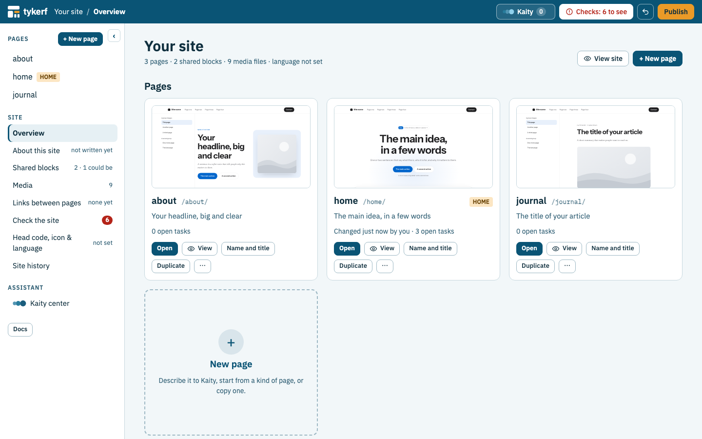
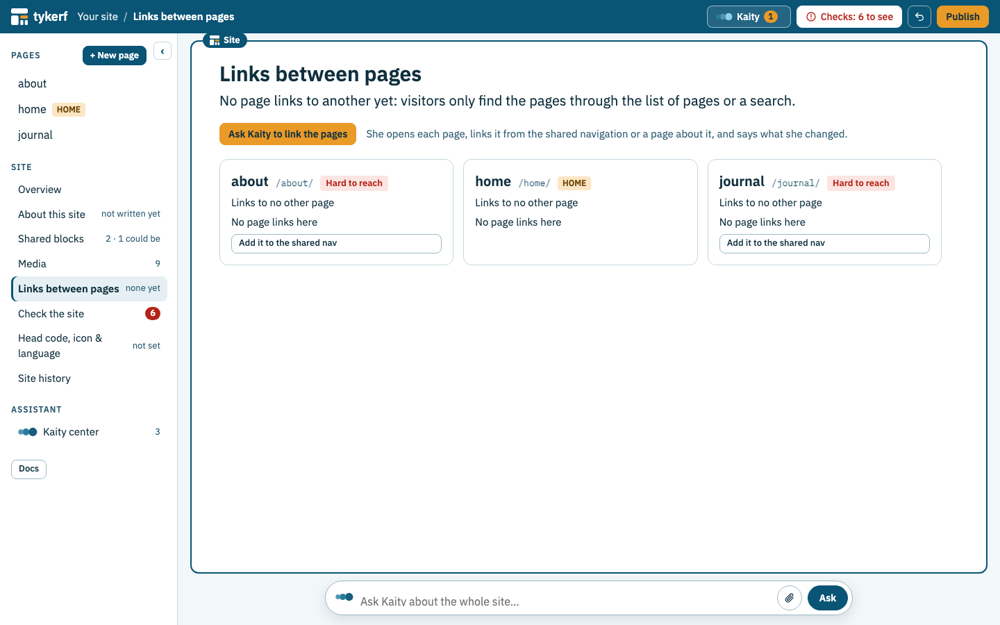
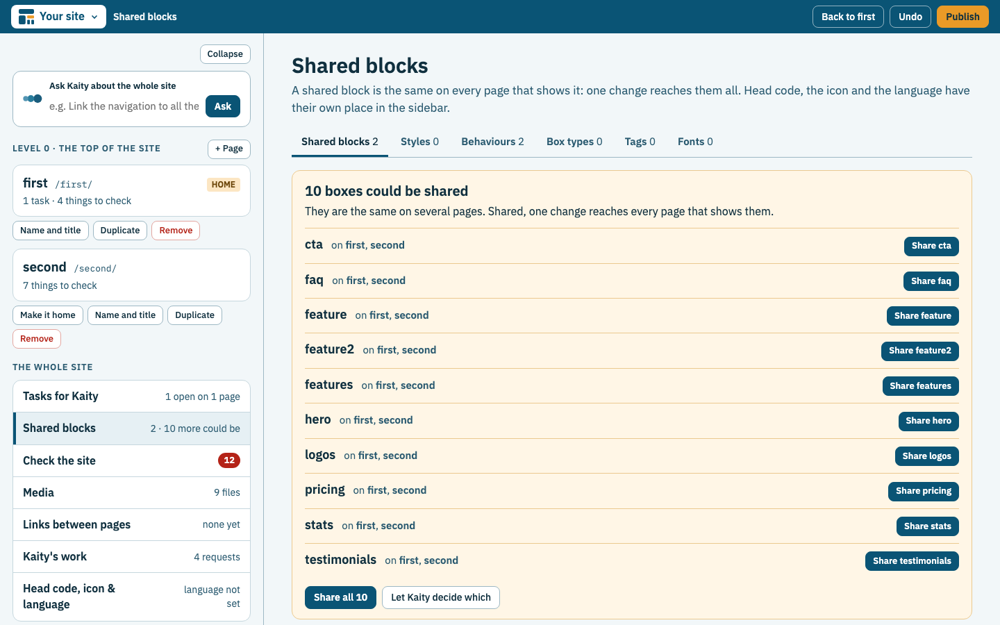

<!-- tykerf:header -->
&nbsp;

[](../../../README.md) › [Documentation](../../README.md) › [User guide](README.md) › **Your site**
<!-- /tykerf:header -->

# Your site

A **site** is a folder of pages, one subfolder each, with what they share next to them:

```
my-site/
  home/          a page (layout.slice, boxes/, head.html, assets/ …)
  about/         another page
  head.html      the site's theme, its fonts and its head code
  kit/           what every page shares besides the theme (see The site kit)
  assets/        the theme's fonts
  site.json      the home page, titles set by hand, the site's language, its brief and frame, where Publish sends the site
  favicon.svg    the site's icon, when you upload one (.svg, .png or .ico)
  .trash/        removed pages, until you empty the trash
```

`npm start -- my-site` opens it at `http://localhost:4400`. Every page is in a site: the first page you make in a new or empty folder (from New page, `--layout`, `npm run cli -- new` or Claude) is the site's **home page**, named `home` unless you name it, and the site's address opens it. To name it, change **Page name** on New page, or give `--name`:

```bash
npm start -- my-site --layout person --name portfolio      # a site whose one page is /portfolio/
npm run cli -- new my-site person --name portfolio         # the same, without opening the editor
```

**Name and title** on its card in the Overview renames it later; it stays the home page.

On a site that has pages already, `--layout` with `--name` adds that page, once (it says so, with the page's address); the same command run again just starts the editor. In a site that shares one theme, the theme you name becomes that page's own values, so the other pages keep their look. Without `--name`, it asks for one:

```bash
npm start -- my-site --layout post --theme ivory --name case-two   # one more page, /case-two/
``` Starting TYKERF on one page of a site (`npm start -- my-site/home`) opens its site. A page folder that isn't in a site is refused, with the two commands that put it in one:

```bash
mkdir my-site && mv my-page my-site/home
npm start -- my-site
```



## The first page

On a **new or empty folder**, TYKERF opens on the Overview's welcome: what tykerf is in three steps, the guides, and **Create your first page** with three starts. Each opens **New page** on it; the first page is named `home` and becomes the home page:
- **Describe it to Kaity:** five questions and the brief they make, with pictures, PDFs or a design ZIP attached; Kaity builds the page ([Kaity](ai.md#start-a-page-with-kaity)).
- **Start from a kind of page:** what the page is, what holds it and the theme the whole site will share, beside a live preview ([layouts](layouts.md)).
- **Copy a web page:** see [copying a website](importing.md).

On a site with pages, **+ New page** also offers **Like a page of this site**: the new page takes that page's navigation, footer and look, with one empty section between them for its own content (a page without a navigation and a footer is copied whole). The page you came from is chosen; click another to start from it.

Page names are lowercase letters, digits and `-`: they are folder names and addresses (`/home/`, `/about/`).

## The site manager

The editor opens on the site manager's **Overview** (`http://localhost:4400/`, or *Your site* in the top bar, or **Overview** in the side panel; the old `/_tykerf/site/` leads there too):

- **Your site**, with how many pages, shared blocks and media files it has and its language; **View site** (see it as visitors do: [View mode](editor.md#view-mode)) and **+ New page**.
- **Pages**: a card for each page, with a small picture of it, its name and address, *Home*, its title, who changed it last and when (point at it for the exact time), its open tasks, and how many of Kaity's changes or questions wait for your review there; **Open**, **View**, **Name and title**, **Duplicate**, and **⋯**, a menu with *Make it home* and *Remove…* (see below; Escape or a click elsewhere closes it). The last card is **New page**.
- **Before you publish**: the design check (*not checked yet*, *out of date* once a page changed after it, *all good* or what to fix: the same as the top bar's **Checks** and the side panel's *Check the site*), About this site, the links between pages, the language and the site's other checks, each with what to do about it. Only what is done shows in green.
- **Kaity lately**: her last three requests, and a box to ask her about the whole site, with **Attach**. *Open Kaity center* shows everything.
- **Learn tykerf**: the guides, online.

Every screen has the same frame: the top bar (*Your site / …*, **Kaity**, **Checks**, one **Undo**, one **Publish**) and the side panel on the left. On the site's screens the side panel lists the **Pages** (**+ New page** at the top), the **Site**'s screens, each with how it stands now (*2 · 1 could be*, *none yet*, *not set*), and the **Kaity center**; at the bottom, **Docs** and **Sign out**. On a page, the side panel is the page's, and all of this is in its **Site** section (see [the frame](editor.md#the-frame)). **‹** folds it to a strip and **›** opens it again; TYKERF remembers it. On a phone it sits above the screen, folded to one line.

| Screen | What it does |
|---|---|
| **Overview** | The pages, what to check before publishing, Kaity lately (above) |
| **About this site** | The site's brief, which Kaity reads before every request: who it is for, its tone, and what a visitor should do; and the frame new pages start in (see below) |
| **Shared blocks** | Boxes that could be shared, the blocks that are, and the rest of [the site kit](#the-site-kit) |
| **Media** | Every file of the site and of its pages, who uses each, and the unused ones (see below) |
| **Links between pages** | Broken links first, then the pages nothing links to (see below) |
| **Check the site** | What to fix before publishing (see below); its count shows in red, and in the top bar's **Checks** |
| **Head code, icon & language** | The code every page gets in its head, the site's icon, its language, and Kaity's status |
| **Site history** | The site's own undo, and its trash (see below) |
| **Kaity center** | Everything Kaity was asked and did, on the whole site and every page ([the Kaity center](ai.md#the-kaity-center)); its *Tasks* filter lists every open task of the site, page by page, with **Give Kaity everything** |
| **Publish** (top bar) | The site, live ([publishing](publishing.md)) |

**About this site** holds the site's **brief**: who it is for, its tone, and the one thing a visitor should do, a short line each. Kaity writes a first version when she builds the site's first page; change it whenever it no longer says what you want, and every later request, on any page, follows it. When something you ask goes against it, Kaity does what you asked and says so, and asks whether the brief should change; she doesn't change it on her own. Below it, **New pages start in** is the frame (simple, basic or full) a new page gets when only its kind is chosen. The site's first page sets it. It is a default: a page may use another frame, and Kaity says why when she picks another one.

### The pages

Each page is a card on the Overview with a small picture of it, its name, its address, *Home* on the home page, and what it has; **Open** opens it in the editor, **View** as visitors see it. Below it, in words (*Make it home* and *Remove…* under **⋯**):

- **Make it home**: visitors get this page at the site's address (`/`).
- **Name and title**: the page's name (its folder and address) and its **title**. Without a title of its own, a page is titled by its first heading; a heading in a shared block (a banner every page shows) doesn't count, since it would give every page the same title. Titles name the pages in the browser tab, in the list of pages and in an export. The full editor's **Page** tab shows the title too, with where it comes from (*from its first heading* or *set by hand*), and a field to change it. Kaity can set titles (`set_title`), and her check tells her when two pages have the same title from their headings, as a duplicated page does until you give it its own.
- **Duplicate**: a copy of the page next to it, named `<name>-copy`, ready to rename. The copy doesn't bring the page's history or its conversations with Kaity.
- **Remove**: after asking, the page goes to the site's trash (its `.trash` folder). **Site history** lists the removed pages with when they were removed, and **Empty the trash for good…** deletes them, after asking again. Until then, move a page's folder from `.trash` back into the site folder to bring it back.

Pages made meanwhile by Kaity, Claude Desktop or the command line appear when you come back to the window.

### Where Kaity is working

While Kaity works, her mark pulses on the top bar's **Kaity** and on the side panel's **Kaity center**, and the Kaity center shows what she is doing now, with **Stop Kaity**. On a page, the line above it says what she is doing; in the full editor, the block she works on carries her balls in the tree.

A page Kaity is working on waits: it can't be renamed, removed or duplicated until she finishes. Nor can a page it links to be renamed, so those links can follow the new name. Every other page can.

### Everything Kaity did

Kaity can work on several pages at once, so on a site of many pages you need one place to see it all: the **Kaity center** (the top bar's **Kaity**, or the side panel). It is one thread, from the oldest to the newest, opened at the newest, next to the box to ask her (see [the Kaity center](ai.md#the-kaity-center)). It is kept in the site's `.tykerf/kaity.jsonl`, the last thousand requests or so.

### Links between pages

Links between pages are written from the site root: `/about/`, `/about/#team`. They work as written in the editor, and an export makes them relative, so the site works at any address. While you edit text, the link box (**⌘K**) and the Text tab's link fields list the site's pages to pick from. Renaming a page changes every link to it, in every page, as one undo step on each.



**Links between pages** says how the pages are linked, in a sentence, then shows:
- **links to pages that don't exist**, each with **Open the box** on the page that holds it, so you can fix it;
- each page, with what it links to and what links to it; a page nothing links to is marked **Hard to reach** (visitors reach it only from the list of pages or a search engine), with **Add it to the shared nav**, which asks Kaity;
- **Ask Kaity to link the pages**, for all of it at once.

### Media

**Media** shows every file: the site's own (in its `assets/` folder, written `/assets/<file>` on any page) and each page's (in the page's `assets/`, written `assets/<file>` on that page), as a grid with a picture of each image, its kind and size, and who uses it: a page's box or head, or the site's head or kit. *Show* narrows it to the site's files, one page's, or the unused ones; the line above says how many there are and their size.

- **Add files…** brings pictures, fonts, PDFs, stylesheets and scripts into the site (or into the page shown): each is checked by its content, up to 25 MB, and a file already there with the same content isn't added twice.
- **Move to the site** makes a page's file the site's: every page that has the same file uses the site's instead, and their own copies go. Do it for a picture several pages use.
- **Use the site's files where pages have copies** does that for every page file the site already has.
- **Remove** (on a file nothing uses) and **Move the N unused files to the trash** take files out; each is a step **Undo** takes back, and the files wait in the site's or the page's trash meanwhile. A file only an undo step still names isn't counted as unused.

What is shared uses the site's files: sharing a box moves the page's files it uses to the site, a picture Kaity draws for the whole site or for a shared block is the site's, and copying a page (*Like this page*, *Duplicate*, Kaity's `new_page` with a copy) takes only the files that page has of its own, never one the site already has.

### Check the site

**Check the site** looks at every page at once and lists what to fix before publishing, each item linking to its page and box: links to pages the site doesn't have, files that aren't there, shared blocks using one page's file, pictures without a text alternative (`alt`), page titles that are missing, too long or the same as another page's, pages no other page links to, a page's own copy of a shared block that equals the block (it could follow the block), fonts without a licence noted, files loaded from other servers, and a site whose language was never set. They come in groups, each with its count and a fix on the spot (a title field, the language, *Add it to the shared nav*, *Open the box*), and each group says whether **Kaity can fix** it or it is **yours to decide**; **Give Kaity the ones she can fix** asks her. Its count shows in the side panel and in the top bar's **Checks**. An export, Publish and Kaity (`check_site`) report the same.

At the bottom, **Check the design** opens every page in a browser at desktop and phone width (a few seconds a page, so only when you press it) and lists, page by page and box by box:

- **To fix**, so people can read and use the page: text too faint on its background, text too small on a phone, buttons and links too small to tap, headings out of order, a page that scrolls sideways on a phone, lines too long or too close together, stretched pictures. **Give Kaity the … to fix** asks her.
- **Style notes**, folded: signs of a generic page (small labels over every section title, a badge above the headline, grids of identical icon cards, the same section again and again, a headline that fills the screen, gradient text and glows, cards inside cards, a coloured stripe down one side of a card, long centred or capital text, only the most common fonts) and holes in a grid (an empty cell the next item would have filled). They aren't errors: keep what you chose on purpose.

Each rule comes with a line saying what it asks and why. Kaity runs the same check (`check_design`) before she finishes a page: she fixes what must be fixed, and for each style note she fixes it or says in her answer why it stays. When she has built a whole page, TYKERF checks it again after her: what must still be fixed goes on her review, with **Fix them** and **Leave them as they are**. On a run over the whole site she can check every page's design at once (`check_site` with `design`).

### Head code

**Head code, icon & language** shows what every page gets in its head that isn't a style: meta tags, scripts, a link to a stylesheet. Scripts here run on every page. Styles for every page go in [the site kit](#the-site-kit), and the theme (colours and fonts) stays in the full editor's Page tab: a new `<style>` here is refused, with a word on where it goes. A site made before keeps the styles its head code has; the screen offers **Move to the kit**, which moves them to `kit/styles/head.css` (each with a comment saying where it came from) as one step **Undo** takes back. From the command line, `npm run cli -- site <dir> migrate-head` does the same. Nothing moves on its own. **Undo**, in the top bar, takes a change back (see [Undo](#undo-and-the-sites-history)).

Above the code is **the site's icon**, the one browser tabs and bookmarks show. TYKERF makes one from the home page's first letter on the theme's accent colour. **Upload an icon…** uses yours instead (SVG, PNG or ICO, up to 512 KB), and **Use the made one** goes back. While you edit, the editor's tabs show TYKERF's mark instead, so they're easy to find; visitors see the site's icon.

Below it is **the site's language**: the language its pages are written in, as a short tag such as `es` (Spanish), `en` (English) or `pt-BR` (Brazilian Portuguese). Every page says it (`<html lang>`), and so do the list of pages and an export; browsers, screen readers and search engines read it. A site is English until you set it, and a site that starts as a copy of a website takes that page's language. Kaity can set it too, when you ask her for the whole site. One language holds for the whole site.

### Undo and the site's history

What the whole site shares has one history, apart from each page's: the theme and the head code, the site kit, and the settings (the home page, page titles, the language, the brief and the frame, where Publish sends the site). **Undo**, in the top bar of the site's screens, takes back the last of those changes, whoever made it (you, or Kaity on the whole site); point at it to see which one it is (*Undo "add kit/styles/note.css"*). **Site history** lists the latest changes, who made them and when, with **Undo** and **Redo** (which brings back what you undid, until the next change). A change Kaity makes as one request, across the kit and the settings, undoes as one step.

Renaming, duplicating or removing a page isn't a step of it: a removed page waits in the trash, and a rename can be made again the other way.

## The site kit



The site kit holds what every page shares besides the theme, one small named file each, in the site's `kit/` folder. **Shared blocks** opens it, with a tab for each kind (Shared blocks, Styles, Behaviours, Box types, Tags, Fonts): each lists its files (click one to edit it, **New** to add one). **Undo**, in the top bar, takes back a change, with the site's other changes. The **Fonts** tab registers a font from the site's files, with its weight, style and licence.

| Kind | What it is | Where it shows |
|---|---|---|
| **Styles** (`kit/styles/<name>.css`) | CSS for every page: a button style, a card | In every page, as one stylesheet every page links (`/kit/site.css`), in file-name order: above the theme, below a page's own head and a box's own styles |
| **Styles for a class** (`kit/styles/<name>.css`, starting `@scope (.k-<name>)`) | A look any element can take, on any page: `class="k-card"` | On every element with the class; a whole box takes it from **Size & look**, under *Class styles* |
| **Behaviours** (`kit/scripts/<name>.js`) | A small script an element turns on with `data-use="<name>"`: `export default function (el) { … }` | On the elements that ask for it, on any page; only the behaviours a page uses load |
| **Shared blocks** (`kit/blocks/<name>.html`) | One box's code that several pages show: the navigation, the footer | In every box that shows it (see below) |
| **Box types** (`kit/types/<name>.json`) | Rules for boxes of a type (see box types) | On every page; a page's own type of the same name wins |
| **Tags** (`kit/tags.json`) | The site's own tags, with a label and a description | In the editor's **Size & look** tab, under *Site tags*; style each as `.t-<tag>` in a styles file |
| **Fonts** (`kit/fonts.json`) | The site's own fonts: each family's files in the site's `assets/`, their weights, and their licence | Declared on every page; the theme and the kit's styles can name them (see below) |

**The order of styles.** Every page's styles come in a fixed order, so a rule never wins by accident: TYKERF's own look, then the theme, then the kit's styles, then a page's own head; a box's own styles (its Code tab) win over all of them. A kit rule can't override a box, however specific it is.

**Styles for a class.** A kit style can be a look any element takes by its class, on any page: **+ A style for a class** starts one, `@scope (.k-card) { :scope { … } }`, named after its class (`card` for `k-card`). Write `class="k-card"` on any element in a box's code (the Code tab lists the site's class styles), or give a whole box the class in **Size & look**, under *Class styles*. A tag `k-card` on a box is that class itself, not `t-k-card`: tags starting `k-` are kept for class styles.

**Fonts.** Besides the fonts TYKERF bundles, a site can have its own: put the font's files (`.woff2` is best) in the site's `assets/` folder, then press **+ New** next to **Fonts** in the kit and give its family name, its file, its weight (`400`, or `100 900` for a variable font), its style and its licence; **Edit JSON** shows `kit/fonts.json` itself. Every page then declares it, and the theme's font fields and the kit's styles can name it. A theme that names a font that is neither bundled nor registered gets a warning, since visitors without it installed see the next font in the list. An export, and Publish, list the fonts with no licence noted: make sure the site may publish them.

**The library's behaviours.** TYKERF ships a few behaviours, ready to use: an element asks for one with `data-use="<name>"`, and the first page that uses one brings it into the site's kit (*the library's*, next to its name), as a component's fonts and pictures come along.

| Behaviour | What it does | The markup it expects |
|---|---|---|
| `form` | The contact form says thank you; with a real `action` (your form service's address) it sends there first | `<form data-use="form" action="…">` (the *Contact form* component) |
| `accordion` | A group of questions with one answer open at a time | an element with `data-use="accordion"` around `<details>` (the *FAQ* component) |
| `year` | The current year, so the footer's © never goes stale | `<span data-use="year">2026</span>` (the *Footer* component) |
| `tabs` | Buttons that each show one panel; the arrow keys move between them | `data-use="tabs"` around `[role=tablist]` with `[role=tab][aria-controls=<id>]`, and `[role=tabpanel][id=<id>]` |
| `carousel` | Slides one at a time, with Previous and Next, announced to screen readers | `data-use="carousel"` around `[data-slides]` and buttons `[data-prev]`, `[data-next]` |
| `reveal` | Fades a section in as it scrolls into view, unless the visitor asks for less motion | `data-use="reveal"` on any element |

Write the attribute in a box's *Code* tab (or ask Kaity), and the site kit gets the behaviour when you save. When a box has a script of its own that does what one of these does, the Code tab says so. If the library's version changes after the site took it (or you changed the site's copy), the kit offers **Update from the library**, which Undo takes back. A page outside a site gets no behaviours: its components still work as plain HTML (the form sends, the questions open).

**A behaviour, step by step.** A behaviour is a small script an element asks for by name. To mark the links a visitor has opened:

1. In the kit, next to **Behaviours**, press **+ New** and name it `seen`. It starts from a template that says what `el` is and how to undo what it does; write:
   ```js
   export default function (el) {
     const mark = () => el.classList.add('seen');
     el.addEventListener('click', mark);
     return () => el.removeEventListener('click', mark);
   }
   ```
2. Put the name on an element, in the box's *Code* tab (or ask Kaity): `<a href="/menu/" data-use="seen">Our menu</a>`.
3. Every page that has such an element runs it; pages that don't never load it. Several behaviours go in one attribute, separated by spaces (`data-use="seen reveal"`). If the function returns a function, TYKERF calls it when the element goes away.

A behaviour is checked when you save it: it must export a function as default (`export default function (el) { … }`), and a mistake in its code is refused, since it would fail on every page. One that fails anyway (on some element it didn't expect) is said in the editor: *A behaviour failed on this page*, with its name; the browser's console says why.

**Shared blocks.** A navigation or a footer is the same on every page, so it is one thing, shared already:
- **A new site's navigation and footer are shared from its first page.** The layout says which of its boxes every page shares (its `nav` and its `footer`); the first page makes them the site's shared blocks, and every page made later from a layout shows them. When you make a page from a layout, *With the site's navigation and footer (shared)* is ticked; untick it and the page gets copies of its own instead.
- A box that shows a shared block has a **shared** chip in the tree and a notice above its tabs, which names the pages that show it and links to it in the site kit (**Open in the site kit**). A change to it (its text, its code, Kaity's) changes every page that shows it. **Undo** on that page takes it back from every page, and says so (*shared block nav, on 8 pages*), as long as it's still the site's last change; once something else changed the site after it, Undo says to use the site's **Undo**, with a link to Site history.
- In the site kit, each shared block lists the pages that show it: a page's name opens it on that box. **Edit block** opens the block's code in the kit's editor.
- **Paste keeps it shared.** A box that shows a shared block, removed and pasted elsewhere (on this page or another), is still that shared block: a later change to it reaches the pasted box too, and its slots stay as they were. Pasted *into* a box, that box shows the block. For a copy of your own, paste it and then take **Make this page's own copy**; for the library's original, use the component instead.
- **Make this page's own copy** gives this page the block as it shows now (its slots filled), to change on its own; the other pages keep the shared block. It's one undo step on the page.
- For a site made before, the kit lists the boxes that are already the same on several pages (*These boxes are the same on several pages…*): **Share nav** makes one shared block from it and shows it on all of those pages. **Share…** on a box in the editor does the same from one page, and offers the site's other shared blocks to show instead.
- Pictures and other files a shared block uses are the site's, not one page's. When you share a box that uses its page's files (a logo in `assets/`), they're copied to the site's `assets/` and the block points at them there (`/assets/logo.png`), so every page shows them; the message after sharing names them. If the site already has a different file of that name, it stays, and the copy gets a name of its own (`logo-1a2b3c….png`).
- A picture you add, crop or copy into a shared block from a page (the image tool) is the site's too, so every page shows it.
- If you write a shared block by hand in the kit with a page's file (`assets/logo.png`), it's saved, with a warning: only that page has the file. Kaity's check lists it on every page that shows the block.
- A link to the page you're on, inside a shared block, is marked as the current page (`aria-current`), so a menu can show where you are. On the home page, links to `/` are marked too. The block itself keeps no such mark: each page gets its own when it's shown.
- Copies of a box that differ only in which link is marked current (each page marking its own) count as the same: the kit offers them as one, saying *they differ only in which link is marked current*, and the shared block it makes has no marks.
- Renaming a page changes the links to it in the shared blocks too, once for every page.

### Slots

A shared block can leave parts to each page: its **slots**. A banner with the page's title, a navigation whose button says something different on one page, a footer line: the block is one, and each page fills in its own.

- In the block's code, an element with `data-slot="title"` is a slot named `title`, and what it holds is the block's own text, shown on any page that doesn't fill it.
- On a page, the Text tab of a box that shows such a block lists its slots, the block's text in grey; what you write is this page's only (**Save for this page**). Editing a slot's text on the page itself does the same; anything outside the slots is the block, every page's.
- The library's **Page banner** has two slots, `title` and `lead`: share it once, show it on every page, and give each page its own title and sentence. The navigation's button (`action`) and the footer's last line (`note`) are slots too.
- Undo takes a slot back like any change of the page. A page's own copy keeps what its slots showed.

**One banner over every page**
1. On one page, use the component *Page banner* in a box under the navigation, and press **Share…** (name it `banner`).
2. On each other page, add a box under the navigation, press **Share…** and choose `banner`.
3. On each page, select the banner and fill its `title` and `lead` in the Text tab, or edit them on the page.

Kaity changes a shared block when you ask her about the whole page (the page block selected), or for the whole site (*Ask Kaity about the whole site*), and she says which pages a change reaches. Asked about a smaller block, she can't change one, but she can fill its slots; she'll suggest selecting the page, or making the page's own copy. Exports and Publish include the kit: its styles in each page, its behaviours as files.

## One theme for every page

The first page's theme becomes the site's: it lives in the site's own `head.html` (with its fonts in the site's `assets/`), and every page uses it before its own `head.html`. Change it in the full editor's **Page** tab of any page (*Every page*); *Undo the last site theme change* sits next to it while the site's last change is the theme's. A page can set some values for itself with *This page only*, and the Page tab always says where a page's look comes from (see [the theme](layouts.md#the-theme)). Copies of websites keep their own look.

Sites made before TYKERF shared themes keep a theme per page. The Page tab of one of their pages offers **Use this theme for every page**: it becomes the site's theme, and the other pages drop their own (one undo step on each).

## Moving between pages

In the editor each page has its own address (`http://localhost:4400/_tykerf/edit/home/`; `/home/` leads there). **Pages**, in the side panel, switch pages; **+ New page** adds one. Open tabs of a renamed page follow it to its new address.

## The site's addresses

| Address | What it is |
|---|---|
| `/` | The home page (until there is one: the site's screens, or for visitors the list of pages) |
| `/<page>/` | A page: in the editor when you are signed in, as it is for visitors |
| `/_tykerf/edit/<page>/?mode=full` | The editor on a page, in the full editor (`/<page>/?tykerf=full` leads there) |
| `/pages/` | Every page by title and address, the home page marked, in the site's theme |
| `/sitemap.xml` | For search engines, when the site's public address is set (`TYKERF_PUBLIC_URL`) |
| `/favicon.svg` | The site's icon (`.png` or `.ico` when you upload one) |
| `/_tykerf/edit/<page>/` | The editor on a page |
| `/_tykerf/edit/_site/<screen>` | The site's screens (`tasks`, `shared`, `check`, `media`, `links`, `kaity`, `settings`, `history`, `publish`, `new`) |

`pages` and `sitemap.xml` can't be page names. `npm run cli -- render my-site` renders every page into its own `out/`.

To put the site online, see [Publishing and serving](publishing.md).

<!-- tykerf:footer -->
---

← [Copying a website](importing.md) · [User guide index](README.md) · [Publishing and serving a site](publishing.md) →

[TYKERF](../../../README.md) · [Documentation](../../README.md) · [GitHub](https://github.com/eonity-org/tykerf) · Apache-2.0 · an [eonity](https://eonity.org) project
<!-- /tykerf:footer -->
