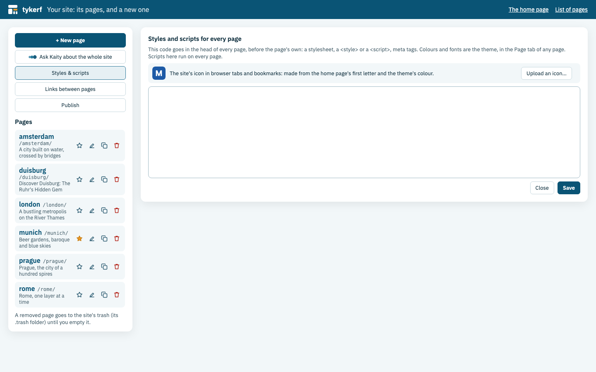
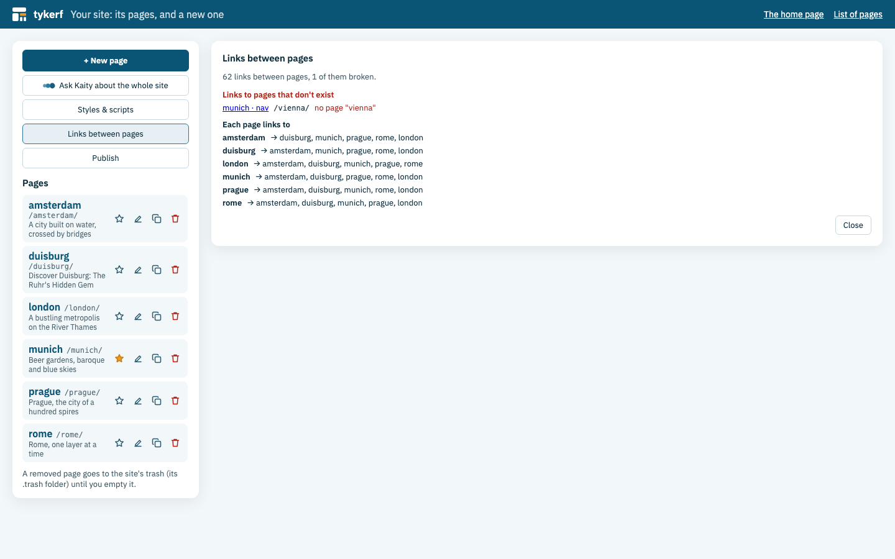

<!-- tykerf:header -->
[](../../../README.md) › [Documentation](../../README.md) › [User guide](README.md) › **Your site**
<!-- /tykerf:header -->

# Your site

A **site** is a folder of pages, one subfolder each, with what they share next to them:

```
my-site/
  home/          a page (layout.slice, boxes/, head.html, assets/ …)
  about/         another page
  head.html      the site's theme and the code every page gets (Styles & scripts)
  assets/        the theme's fonts
  site.json      the home page, titles set by hand, where Publish sends the site
  favicon.svg    the site's icon, when you upload one (.svg, .png or .ico)
  .trash/        removed pages, until you empty the trash
```

`npm start -- my-site` opens it at `http://localhost:4400`. A folder that is **one page** (it has a `layout.slice`, like `examples/widgets`) is edited on its own at `http://localhost:4400/`.



## The first page

On a **new or empty folder**, TYKERF shows the **start screen**. Give the first page a name (`home`) and choose how to start:
- **Show or describe it:** words, up to three pictures and/or a design ZIP; Kaity builds the page ([Kaity](ai.md#start-a-page-with-kaity)).
- **A layout:** pick one and a theme while the preview shows them ([layouts](layouts.md)).
- **A copy of a website:** see [copying a website](importing.md).

Page names are lowercase letters, digits and `-`: they are folder names and addresses (`/home/`, `/about/`).

## The site manager

The site manager is at `http://localhost:4400/_tykerf/site/`. From any page, the **Manage the site** button next to *Edit with TYKERF* opens it, and so do *Manage the site…* in the Site menu and **All pages** in the page list. Until the site has a home page, `http://localhost:4400/` opens it too.

It starts with what acts on the whole site:

| Button | What it does |
|---|---|
| **+ New page** | The ways to start a page, step by step; the button that makes the page always stays in sight |
| **Ask Kaity about the whole site** | Kaity works across pages: she opens each, changes it and checks it ([Kaity for the whole site](ai.md#kaity-for-the-whole-site)) |
| **Styles & scripts** | The site's icon, and the code every page gets in its head (see below) |
| **Links between pages** | Broken links first, then the pages nothing links to (see below) |
| **Publish** | The site, live on GitHub Pages, Cloudflare Pages or Netlify ([publishing](publishing.md)) |

### The pages

Each page shows its name, its address and its title, and four icons; their names show when you point at them:

- **Make home** (the star): visitors get this page at the site's address (`/`). The home page's star is filled.
- **Rename** (the pencil): the page's name (its folder and address) and its **title**. Without a title of its own, a page is titled by its first heading. Titles name the pages in the browser tab, in the list of pages and in an export.
- **Duplicate**: a copy of the page next to it, named `<name>-copy`, ready to rename. The copy doesn't bring the page's history or its conversations with Kaity.
- **Remove** (the bin): after asking, the page goes to the site's trash (its `.trash` folder). **Removed pages** lists them with when they were removed, and **Empty the trash** deletes them for good, after asking again. Until then, move a page's folder from `.trash` back into the site folder to bring it back.

Pages made meanwhile by Kaity, Claude Desktop or the command line appear in the list by themselves.

### Where Kaity is working

While Kaity works, **Kaity is working** appears above the list: the whole site, or each page with the block she's on. Her three balls pulse next to those pages, and each one opens the page on her block's Kaity tab. In the page itself, the block she works on carries her balls in the tree, and any other block's Kaity tab says where she is, with **Go there**.

A page Kaity is working on waits: it can't be renamed, removed or duplicated until she finishes. Nor can a page it links to be renamed, so those links can follow the new name. Every other page can.

### Links between pages

Links between pages are written from the site root: `/about/`, `/about/#team`. They work as written in the editor, and an export makes them relative, so the site works at any address. While you edit text, the link box (**⌘K**) and the Text tab's link fields list the site's pages to pick from. Renaming a page changes every link to it, in every page, as one undo step on each.



**Links between pages** in the manager shows:
- **links to pages that don't exist**, each opening the page on the box that holds it (its Text tab), so you can fix it;
- **pages no other page links to:** visitors reach them only from the list of pages or a search engine;
- **what each page links to.**

### Styles & scripts

The code every page gets in its head, before the page's own: a stylesheet, a `<style>`, a `<script>`, meta tags. Scripts here run on every page. The theme (colours and fonts) isn't in it; that stays in the Page tab. It has its own **Undo**.

Above the code is **the site's icon**, the one browser tabs and bookmarks show. TYKERF makes one from the home page's first letter on the theme's accent colour. **Upload an icon…** uses yours instead (SVG, PNG or ICO, up to 512 KB), and **Use the made one** goes back. While you edit, the editor's tabs show TYKERF's mark instead, so they're easy to find; visitors see the site's icon.

## One theme for every page

The first page's theme becomes the site's: it lives in the site's own `head.html` (with its fonts in the site's `assets/`), and every page uses it before its own `head.html`. Change it in the **Page** tab of any page (*Every page*); *Undo the last site theme change* sits next to it. A page can set some values for itself with *This page only*, and the Page tab always says where a page's look comes from (see [the theme](layouts.md#the-theme)). Copies of websites keep their own look.

Sites made before TYKERF shared themes keep a theme per page. The Page tab of one of their pages offers **Use this theme for every page**: it becomes the site's theme, and the other pages drop their own (one undo step on each).

## Moving between pages

In the editor each page has its own address (`http://localhost:4400/home/`). The **page name** next to the TYKERF logo lists the site's pages to switch to; **All pages** opens the site manager, and **New page…** adds one, with the same choices as the start screen plus **Like this page**: the current page's navigation, footer and theme, with one empty section in between.

Next to the current page in that list, **Rename this page…** (the pencil) and **Remove this page…** (the bin) do what the manager's icons do; removing first says how many links to it will point nowhere. Open tabs of a renamed page follow it to its new address.

## The site's addresses

| Address | What it is |
|---|---|
| `/` | The home page (until there is one: the site manager, or for visitors the list of pages) |
| `/<page>/` | A page |
| `/pages/` | Every page by title and address, the home page marked, in the site's theme |
| `/sitemap.xml` | For search engines, when the site's public address is set (`TYKERF_PUBLIC_URL`) |
| `/favicon.svg` | The site's icon (`.png` or `.ico` when you upload one) |
| `/_tykerf/site/` | The site manager |

`pages` and `sitemap.xml` can't be page names. `npm run cli -- render my-site` renders every page into its own `out/`.

To put the site online, see [Publishing and serving](publishing.md).

<!-- tykerf:footer -->
---

← [Copying a website](importing.md) · [User guide index](README.md) · [Publishing and serving a site](publishing.md) →

[TYKERF](../../../README.md) · [Documentation](../../README.md) · [GitHub](https://github.com/eonity-org/tykerf) · Apache-2.0 · an [eonity](https://eonity.org) project
<!-- /tykerf:footer -->
